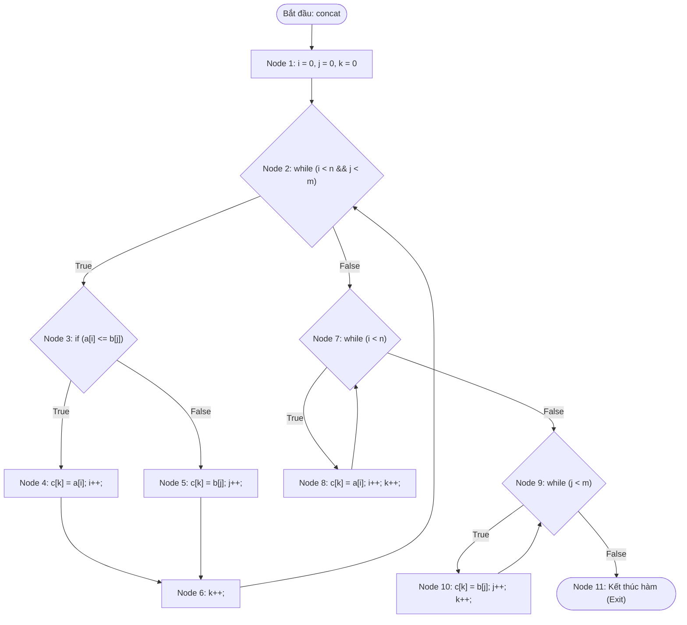
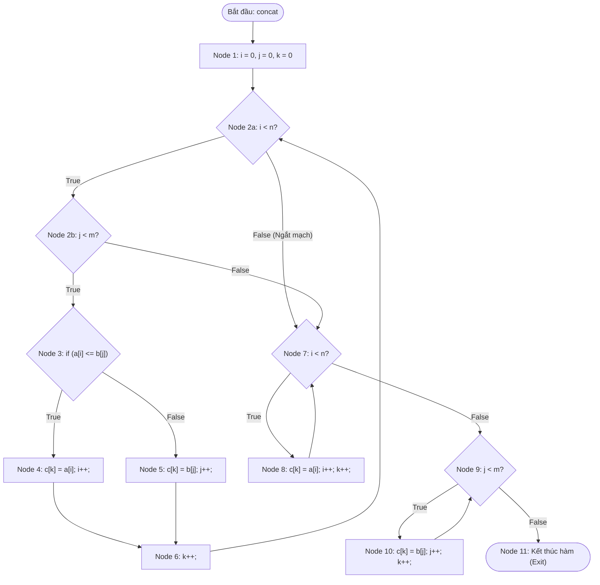
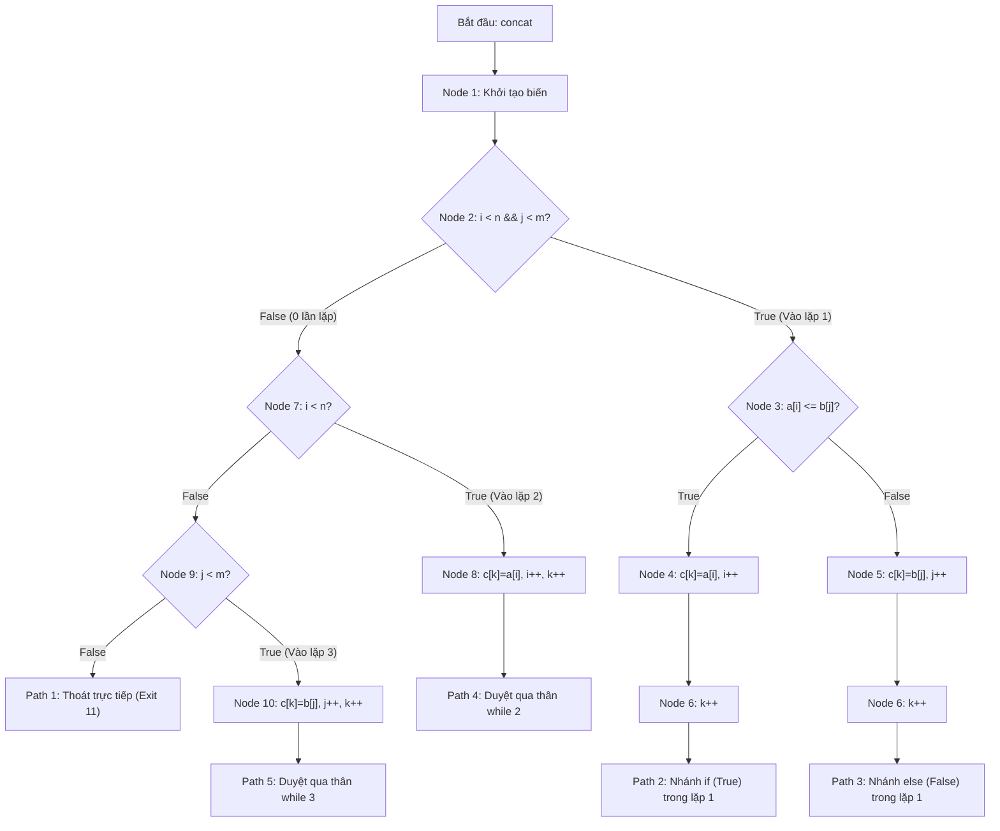

# BÁO CÁO KIỂM THỬ HỘP TRẮNG (WHITE-BOX TESTING)

## BÀI THI: PHÂN TÍCH ĐỒ THỊ DÒNG ĐIỀU KHIỂN & ĐỘ ĐO BAO PHỦ C1, C2, C3 CHO HÀM `concat`

---

## THÔNG TIN CHUNG VỀ ĐỐI TƯỢNG KIỂM THỬ

- **Học phần:** Kiểm thử và Đảm bảo chất lượng phần mềm (CSE462)
- **Học kỳ:** Học kỳ 7 – Năm học 2025–2026
- **Giảng viên hướng dẫn:** TS. Nguyễn Thị Phương Dung
- **Sinh viên thực hiện:** Phùng Văn Duy
- **Mã sinh viên:** 2351170589 | **Nhóm:** 09
- **Đối tượng kiểm thử (Target Under Test):** Hàm `concat(int a[], int n, int b[], int m, int c[], int &k)`
- **Tệp mã nguồn:** `test.cpp`
- **Mô tả chức năng:** Hàm thực hiện trộn (ghép) hai mảng số nguyên đã sắp xếp `a` (kích thước `n`) và `b` (kích thước `m`) thành mảng kết quả `c` có thứ tự tăng dần với tổng số phần tử lưu trong biến tham chiếu `k`.
- **Tài liệu lý thuyết tham chiếu:** 
  - Slide bài giảng *CSE462 - Các kỹ thuật kiểm thử phần mềm*, Trường Đại học Thủy Lợi (Nội dung: Kiểm thử dòng điều khiển Control Flow Testing, Đồ thị CFG, Độ đo bao phủ C1, C2, C3, Độ phức tạp Cyclomatic $V(G)$ theo McCabe, Kiểm thử vòng lặp Loop Testing, Kiểm thử dòng dữ liệu Data Flow Testing Def-Use).
  - Báo cáo mẫu kiểm thử hộp trắng: `hop-trang/KiemThuHopTrang_UC06_UploadCV.md`.

---

## 1. MÃ NGUỒN ĐÁNH SỐ DÒNG

Dưới đây là mã nguồn của hàm `concat` trong tệp `test.cpp` được chuẩn hóa và đánh số dòng theo các lệnh thực thi:

```cpp
1:  void concat(int a[], int n, int b[], int m, int c[], int &k) {
2:    int i = 0, j = 0;
3:    k = 0;
4:    while (i < n && j < m) {
5:      if (a[i] <= b[j]) {
6:        c[k] = a[i];
7:        i++;
8:      }
9:      else {
10:       c[k] = b[j];
11:       j++;
12:     }
13:     k++;
14:   }
15:   while (i < n) {
16:     c[k] = a[i];
17:     i++;
18:     k++;
19:   }
20:   while (j < m) {
21:     c[k] = b[j];
22:     j++;
23:     k++;
24:   }
25: }
```

---

## 2. PHÂN TÍCH KHỐI LỆNH CƠ BẢN VÀ ĐỒ THỊ DÒNG ĐIỀU KHIỂN (CFG)

### 2.1. Danh sách các khối lệnh cơ bản (Basic Blocks / Nodes)

Dựa trên nguyên lý khối cơ bản (Basic Block là một chuỗi các câu lệnh thực thi tuần tự, có duy nhất một điểm vào và một điểm ra), mã nguồn được phân rã thành 11 khối lệnh (Nodes) như sau:

| Khối (Node) | Dòng mã nguồn | Nội dung thực thi chi tiết | Loại đỉnh (Node Type) |
| :---: | :--- | :--- | :--- |
| **Node 1** | Dòng 2–3 | Khởi tạo các biến chỉ số: `i = 0, j = 0; k = 0;` | Process (Xử lý khởi tạo) |
| **Node 2** | Dòng 4 | Kiểm tra điều kiện vòng lặp 1: `while (i < n && j < m)` | Decision (Điểm quyết định 1) |
| **Node 3** | Dòng 5 | So sánh phần tử: `if (a[i] <= b[j])` | Decision (Điểm quyết định 2) |
| **Node 4** | Dòng 6–7 | Nhánh True của if: `c[k] = a[i]; i++;` | Process (Xử lý) |
| **Node 5** | Dòng 10–11 | Nhánh False (else) của if: `c[k] = b[j]; j++;` | Process (Xử lý) |
| **Node 6** | Dòng 13 | Tăng chỉ số mảng kết quả sau if-else: `k++;` | Process (Xử lý) |
| **Node 7** | Dòng 15 | Kiểm tra điều kiện vòng lặp 2: `while (i < n)` | Decision (Điểm quyết định 3) |
| **Node 8** | Dòng 16–18 | Thân vòng lặp 2: `c[k] = a[i]; i++; k++;` | Process (Xử lý) |
| **Node 9** | Dòng 20 | Kiểm tra điều kiện vòng lặp 3: `while (j < m)` | Decision (Điểm quyết định 4) |
| **Node 10** | Dòng 21–23 | Thân vòng lặp 3: `c[k] = b[j]; j++; k++;` | Process (Xử lý) |
| **Node 11** | Dòng 25 | Kết thúc hàm (Return / Exit) | Exit (Điểm thoát hàm) |

---

### 2.2. Đồ thị dòng điều khiển chuẩn (Control Flow Graph - CFG cho C1 và C2)

Đồ thị dưới đây mô tả luồng điều khiển ở cấp độ khối lệnh cơ bản (Basic Block CFG), phản ánh chính xác các điểm rẽ nhánh của cấu trúc điều khiển:



---

### 2.3. Đồ thị dòng điều khiển chi tiết mở rộng cho độ đo C3 (Detailed Decision CFG)

Trong biểu thức phức hợp tại Node 2 `(i < n && j < m)`, ngôn ngữ C/C++ sử dụng cơ chế ngắt mạch (**Short-circuit evaluation**). Để kiểm thử bao phủ toàn diện cấp 3 (**Độ đo C3 - Multiple Condition Coverage**), điểm quyết định Node 2 được mở rộng thành hai nút quyết định thành phần:
- **Node 2a:** Điều kiện con `i < n`
- **Node 2b:** Điều kiện con `j < m`

Nếu `i < n` nhận giá trị **False**, biểu thức lập tức ngắt mạch và nhảy thẳng sang Node 7 mà không cần kiểm tra `j < m`.



---

## 3. TÍNH ĐỘ PHỨC TẠP CYCLOMATIC (MCCABE)

Độ phức tạp Cyclomatic $V(G)$ của đồ thị dòng điều khiển đo lường số lượng đường dẫn độc lập tuyến tính tối thiểu cần thiết để bao phủ toàn bộ cấu trúc mã nguồn. Được tính toán độc lập theo 3 phương pháp chuẩn của Thomas J. McCabe:

### A. Tính toán trên Đồ thị dòng điều khiển chuẩn (Mức khối cơ bản - C1, C2)

#### Phương pháp 1: Dựa trên số cung ($E$) và số đỉnh ($N$)
Công thức:
$$V(G) = E - N + 2P$$
Trong đó:
- Số đỉnh (Nodes) $N = 11$ (từ Node 1 đến Node 11)
- Số cung (Edges) $E = 14$, gồm danh sách các cung:
  1. $(1 \rightarrow 2)$
  2. $(2 \rightarrow 3)$ [Nhánh True của while 1]
  3. $(2 \rightarrow 7)$ [Nhánh False của while 1]
  4. $(3 \rightarrow 4)$ [Nhánh True của if]
  5. $(3 \rightarrow 5)$ [Nhánh False của if]
  6. $(4 \rightarrow 6)$
  7. $(5 \rightarrow 6)$
  8. $(6 \rightarrow 2)$ [Quay lại kiểm tra while 1]
  9. $(7 \rightarrow 8)$ [Nhánh True của while 2]
  10. $(7 \rightarrow 9)$ [Nhánh False của while 2]
  11. $(8 \rightarrow 7)$ [Quay lại kiểm tra while 2]
  12. $(9 \rightarrow 10)$ [Nhánh True của while 3]
  13. $(9 \rightarrow 11)$ [Nhánh False của while 3]
  14. $(10 \rightarrow 9)$ [Quay lại kiểm tra while 3]
- Số thành phần liên thông $P = 1$ (chương trình đơn luồng, 1 đồ thị kết nối)

Áp dụng công thức:
$$V(G) = 14 - 11 + 2(1) = 5$$

---

#### Phương pháp 2: Dựa trên số nút quyết định vị từ ($P_{nodes}$)
Công thức:
$$V(G) = P_{nodes} + 1$$
Trong đó, $P_{nodes}$ là số nút vị từ có 2 nhánh rẽ True/False trong đồ thị:
1. **Node 2:** `while (i < n && j < m)`
2. **Node 3:** `if (a[i] <= b[j])`
3. **Node 7:** `while (i < n)`
4. **Node 9:** `while (j < m)`

Tổng số nút vị từ: $P_{nodes} = 4$.  
Áp dụng công thức:
$$V(G) = 4 + 1 = 5$$

---

#### Phương pháp 3: Dựa trên số miền khép kín ($R$)
Công thức:
$$V(G) = R$$
Số miền mặt phẳng được phân chia bởi đồ thị phẳng gồm 4 miền đóng và 1 miền mở vô hạn bên ngoài:
- **Miền $R_1$ (Chu trình nhánh True của if trong while 1):** Giới hạn bởi chu trình $2 \rightarrow 3 \rightarrow 4 \rightarrow 6 \rightarrow 2$.
- **Miền $R_2$ (Vùng rẽ nhánh if-else):** Giới hạn bởi $3 \rightarrow 4 \rightarrow 6$ và $3 \rightarrow 5 \rightarrow 6$.
- **Miền $R_3$ (Chu trình while 2):** Giới hạn bởi $7 \rightarrow 8 \rightarrow 7$.
- **Miền $R_4$ (Chu trình while 3):** Giới hạn bởi $9 \rightarrow 10 \rightarrow 9$.
- **Miền $R_5$ (Miền hở bao quanh bên ngoài):** Mặt phẳng ngoài đi dọc theo đường dẫn chính $1 \rightarrow 2 \rightarrow 7 \rightarrow 9 \rightarrow 11$.

Tổng số miền: $R = 5$ miền.  
Áp dụng công thức:
$$V(G) = 5$$

$\Rightarrow$ **Kết luận:** Cả 3 phương pháp đều cho kết quả nhất quán: **$V(G) = 5$**. Đồ thị cần tối thiểu **5 đường cơ sở độc lập tuyến tính** để bao phủ kiểm thử.

---

### B. Tính toán trên Đồ thị mở rộng tách điều kiện con (Mức C3)
Khi tách điều kiện phức hợp `while (i < n && j < m)` thành hai nút quyết định `Node 2a` và `Node 2b`:
- Số đỉnh $N = 12$ (thêm 1 nút điều kiện con)
- Số cung $E = 16$
- Số nút vị từ $P_{nodes} = 5$ (Node 2a, 2b, 3, 7, 9)
- Độ phức tạp Cyclomatic mở rộng:
  $$V(G) = E - N + 2P = 16 - 12 + 2(1) = 6$$
  $$V(G) = P_{nodes} + 1 = 5 + 1 = 6$$

---

## 4. TẬP ĐƯỜNG CƠ SỞ (BASIS PATHS)

Tập 5 đường dẫn cơ sở độc lập tuyến tính bao phủ toàn bộ các cạnh và đỉnh trong đồ thị dòng điều khiển chuẩn:

- **Path 1 (Trường hợp rỗng - Thoát ngay cả 3 vòng lặp):**
  $$1 \rightarrow 2 \rightarrow 7 \rightarrow 9 \rightarrow 11$$
  *(Xảy ra khi cả hai mảng đều rỗng $n = 0, m = 0$, không có vòng lặp nào được thực thi).*

- **Path 2 (Vòng lặp 1 duyệt nhánh True của if `a[i] <= b[j]` rồi kết thúc):**
  $$1 \rightarrow 2 \rightarrow 3 \rightarrow 4 \rightarrow 6 \rightarrow 2 \rightarrow 7 \rightarrow 9 \rightarrow 11$$
  *(Xảy ra khi vòng lặp 1 chạy ít nhất 1 lần chọn $a[i]$, sau đó thoát vòng lặp và hai mảng đều hết).*

- **Path 3 (Vòng lặp 1 duyệt nhánh False của if `a[i] > b[j]` rồi kết thúc):**
  $$1 \rightarrow 2 \rightarrow 3 \rightarrow 5 \rightarrow 6 \rightarrow 2 \rightarrow 7 \rightarrow 9 \rightarrow 11$$
  *(Xảy ra khi vòng lặp 1 chạy ít nhất 1 lần chọn $b[j]$, sau đó thoát vòng lặp).*

- **Path 4 (Duyệt qua thân vòng lặp 2 `while (i < n)`):**
  $$1 \rightarrow 2 \rightarrow 7 \rightarrow 8 \rightarrow 7 \rightarrow 9 \rightarrow 11$$
  *(Xảy ra khi mảng $b$ rỗng hoặc hết trước, mảng $a$ vẫn còn phần tử cần sao chép sang $c$).*

- **Path 5 (Duyệt qua thân vòng lặp 3 `while (j < m)`):**
  $$1 \rightarrow 2 \rightarrow 7 \rightarrow 9 \rightarrow 10 \rightarrow 9 \rightarrow 11$$
  *(Xảy ra khi mảng $a$ rỗng hoặc hết trước, mảng $b$ vẫn còn phần tử cần sao chép sang $c$).*

---

### Sơ đồ cây phân nhánh các đường dẫn cơ sở (Basis Paths Tree Diagram)



---

## 5. SINH CÁC ĐƯỜNG ĐI VÀ CÁC CA KIỂM THỬ VỚI ĐỘ ĐO C1, C2, C3

Theo tài liệu bài giảng *CSE462 - Các kỹ thuật kiểm thử phần mềm*, ĐH Thủy Lợi, dưới đây là quá trình phân tích và sinh tập đường đi, ca kiểm thử tối thiểu nhằm đạt 100% độ bao phủ cho từng độ đo kiểm thử hộp trắng:

---

### 5.1. Sinh các đường đi và các ca kiểm thử với độ đo C1 (Statement Coverage)

#### A. Tiêu chuẩn độ đo C1:
- **Định nghĩa:** Mỗi câu lệnh (khối lệnh cơ bản / đỉnh trong CFG) phải được thực thi ít nhất một lần sau khi chạy toàn bộ các ca kiểm thử.
- **Yêu cầu đối với hàm `concat`:** Cần đi qua toàn bộ **11 đỉnh** ($N_1, N_2, N_3, N_4, N_5, N_6, N_7, N_8, N_9, N_{10}, N_{11}$).
- **Xác định số ca kiểm thử tối thiểu:**
  - Để đi qua $N_4$ (nhánh True của if) và $N_5$ (nhánh False của if), vòng lặp 1 cần chạy qua cả hai tình huống $a[i] \le b[j]$ và $a[i] > b[j]$.
  - Để đi qua $N_8$ (thân while 2), cần tình huống mảng $a$ còn phần tử ($i < n$).
  - Để đi qua $N_{10}$ (thân while 3), cần tình huống mảng $b$ còn phần tử ($j < m$).
  $\Rightarrow$ **Tối thiểu cần 2 ca kiểm thử** (`Tc1_C1` và `Tc2_C1`) để bao phủ toàn bộ 11 đỉnh.

#### B. Bảng các đỉnh cần bao phủ:
| Đỉnh (Node) | Nội dung thực thi | Ca kiểm thử kích hoạt |
| :---: | :--- | :---: |
| **Node 1** | Khởi tạo `i = 0, j = 0, k = 0` | `Tc1_C1, Tc2_C1` |
| **Node 2** | Kiểm tra `while (i < n && j < m)` | `Tc1_C1, Tc2_C1` |
| **Node 3** | Điều kiện `if (a[i] <= b[j])` | `Tc1_C1` |
| **Node 4** | Gán `c[k] = a[i]; i++` | `Tc1_C1` |
| **Node 5** | Gán `c[k] = b[j]; j++` | `Tc1_C1` |
| **Node 6** | Tăng `k++` | `Tc1_C1` |
| **Node 7** | Kiểm tra `while (i < n)` | `Tc1_C1, Tc2_C1` |
| **Node 8** | Gán `c[k] = a[i]; i++; k++` | `Tc1_C1` |
| **Node 9** | Kiểm tra `while (j < m)` | `Tc1_C1, Tc2_C1` |
| **Node 10** | Gán `c[k] = b[j]; j++; k++` | `Tc2_C1` |
| **Node 11** | Thoát hàm (Exit) | `Tc1_C1, Tc2_C1` |

#### C. Bảng sinh đường đi và ca kiểm thử cho độ đo C1:
| TT | Đường đi thực thi (Chuỗi đỉnh qua) | Đầu vào (Input) | Đầu ra mong đợi (Expected Output) | Đỉnh bao phủ |
| :---: | :--- | :--- | :--- | :---: |
| **`Tc1_C1`** | $1 \rightarrow 2 \rightarrow 3 \rightarrow 4 \rightarrow 6 \rightarrow 2 \rightarrow 3 \rightarrow 5 \rightarrow 6 \rightarrow 2 \rightarrow 7 \rightarrow 8 \rightarrow 7 \rightarrow 9 \rightarrow 11$ | $a = [1, 4], n = 2$<br>$b = [2], m = 1$ | $c = [1, 2, 4]$<br>$k = 3$ | $1, 2, 3, 4, 5, 6, 7, 8, 9, 11$ |
| **`Tc2_C1`** | $1 \rightarrow 2 \rightarrow 7 \rightarrow 9 \rightarrow 10 \rightarrow 9 \rightarrow 11$ | $a = [], n = 0$<br>$b = [5], m = 1$ | $c = [5]$<br>$k = 1$ | $1, 2, 7, 9, 10, 11$ |

$\Rightarrow$ **Độ bao phủ C1 đạt được:** $\frac{11}{11} \text{ Nodes} = \mathbf{100\%}$.

---

### 5.2. Sinh các đường đi và các ca kiểm thử với độ đo C2 (Branch / Decision Coverage)

#### A. Tiêu chuẩn độ đo C2:
- **Định nghĩa:** Các điểm quyết định trong đồ thị dòng điều khiển của đơn vị kiểm thử đều phải được thực hiện ít nhất một lần cả hai nhánh Đúng (True) và Sai (False).
- **Yêu cầu đối với hàm `concat`:** Có 4 điểm quyết định nhị phân, gồm tổng cộng **8 nhánh rẽ**:
  1. Node 2: Nhánh True ($2 \rightarrow 3$), Nhánh False ($2 \rightarrow 7$).
  2. Node 3: Nhánh True ($3 \rightarrow 4$), Nhánh False ($3 \rightarrow 5$).
  3. Node 7: Nhánh True ($7 \rightarrow 8$), Nhánh False ($7 \rightarrow 9$).
  4. Node 9: Nhánh True ($9 \rightarrow 10$), Nhánh False ($9 \rightarrow 11$).
- **Số ca kiểm thử tối thiểu:** **3 ca kiểm thử** (`Tc1_C2`, `Tc2_C2`, `Tc3_C2`).

#### B. Bảng các trường hợp cần kiểm thử để đạt 100% độ bao phủ C2:
| Điểm quyết định | Điều kiện tương ứng | Nhánh Đúng (True) | Nhánh Sai (False) |
| :---: | :--- | :---: | :---: |
| **Node 2** | `while (i < n && j < m)` | `Tc1_C2, Tc2_C2` | `Tc1_C2, Tc2_C2, Tc3_C2` |
| **Node 3** | `if (a[i] <= b[j])` | `Tc1_C2` | `Tc2_C2` |
| **Node 7** | `while (i < n)` | `Tc1_C2` | `Tc2_C2, Tc3_C2` |
| **Node 9** | `while (j < m)` | `Tc2_C2` | `Tc1_C2, Tc3_C2` |

#### C. Bảng sinh đường đi và ca kiểm thử cho độ đo C2:
| TT | Đường đi thực thi chi tiết | Đầu vào (Input) | Đầu ra mong đợi | Nhánh bao phủ |
| :---: | :--- | :--- | :--- | :--- |
| **`Tc1_C2`** | $1 \rightarrow 2 \xrightarrow{T} 3 \xrightarrow{T} 4 \rightarrow 6 \rightarrow 2 \xrightarrow{F} 7 \xrightarrow{T} 8 \rightarrow 7 \xrightarrow{F} 9 \xrightarrow{F} 11$ | $a = [1, 5], n = 2$<br>$b = [3], m = 1$ | $c = [1, 3, 5]$<br>$k = 3$ | Node 2 (True, False)<br>Node 3 (True)<br>Node 7 (True, False)<br>Node 9 (False) |
| **`Tc2_C2`** | $1 \rightarrow 2 \xrightarrow{T} 3 \xrightarrow{F} 5 \rightarrow 6 \rightarrow 2 \xrightarrow{F} 7 \xrightarrow{F} 9 \xrightarrow{T} 10 \rightarrow 9 \xrightarrow{F} 11$ | $a = [4], n = 1$<br>$b = [2, 6], m = 2$ | $c = [2, 4, 6]$<br>$k = 3$ | Node 2 (True, False)<br>Node 3 (False)<br>Node 7 (False)<br>Node 9 (True, False) |
| **`Tc3_C2`** | $1 \rightarrow 2 \xrightarrow{F} 7 \xrightarrow{F} 9 \xrightarrow{F} 11$ | $a = [], n = 0$<br>$b = [], m = 0$ | $c = []$<br>$k = 0$ | Node 2 (False ngay đầu)<br>Node 7 (False)<br>Node 9 (False) |

$\Rightarrow$ **Độ bao phủ C2 đạt được:** $\frac{8}{8} \text{ Nhánh} = \mathbf{100\%}$.

---

### 5.3. Sinh các đường đi và các ca kiểm thử với độ đo C3 (Multiple Condition / Condition Coverage)

#### A. Tiêu chuẩn độ đo C3:
- **Định nghĩa:** Các điều kiện con thuộc các điều kiện phức tạp tương ứng với các điểm quyết định trong đồ thị dòng điều khiển đều phải được thực hiện ít nhất một lần cả hai nhánh Đúng (True) và Sai (False).
- **Phân tích điểm quyết định phức hợp:**
  Tại **Node 2** có biểu thức logic phức hợp `(i < n && j < m)` gồm 2 điều kiện con:
  - $C_{2a} = (i < n)$
  - $C_{2b} = (j < m)$
  Cơ chế ngắt mạch (**Short-circuit evaluation**) của toán tử `&&`: Nếu $C_{2a}$ nhận giá trị **False**, biểu thức kết luận ngay **False** mà không đánh giá $C_{2b}$.
- **Các điểm quyết định đơn lẻ:**
  - Node 3: $C_3 = (a[i] \le b[j])$
  - Node 7: $C_7 = (i < n)$
  - Node 9: $C_9 = (j < m)$

#### B. Bảng phân tích tổ hợp giá trị chân lý tại Node 2 `(i < n && j < m)`:
| Tổ hợp | $C_{2a}$ (`i < n`) | $C_{2b}$ (`j < m`) | Kết quả `&&` | Nhánh rẽ / Hành vi | Ca kiểm thử tương ứng |
| :---: | :---: | :---: | :---: | :--- | :---: |
| **Cond 1** | **True** | **True** | **True** | Lặp tiếp, vào Node 3 | `Tc1_C3, Tc2_C3` |
| **Cond 2** | **True** | **False** | **False** | Thoát while 1 sang Node 7 | `Tc1_C3, Tc3_C3` |
| **Cond 3** | **False** | *(Ngắt mạch)* | **False** | Thoát while 1 sang Node 7 | `Tc2_C3, Tc4_C3` |
| **Cond 4** | **False** | **False** | **False** | Cả hai mảng rỗng ban đầu | `Tc5_C3` |

#### C. Bảng các trường hợp cần kiểm thử để đạt 100% độ bao phủ C3:
| Điểm quyết định | Điều kiện con tương ứng | Đúng (True) | Sai (False) |
| :---: | :--- | :---: | :---: |
| **Node 2** | $C_{2a}: i < n$ | `Tc1_C3, Tc2_C3, Tc3_C3` | `Tc2_C3, Tc4_C3, Tc5_C3` |
| **Node 2** | $C_{2b}: j < m$ | `Tc1_C3, Tc2_C3, Tc4_C3` | `Tc1_C3, Tc3_C3, Tc5_C3` |
| **Node 3** | $C_3: a[i] \le b[j]$ | `Tc1_C3` | `Tc2_C3` |
| **Node 7** | $C_7: i < n$ | `Tc1_C3, Tc3_C3` | `Tc2_C3, Tc4_C3, Tc5_C3` |
| **Node 9** | $C_9: j < m$ | `Tc2_C3, Tc4_C3` | `Tc1_C3, Tc3_C3, Tc5_C3` |

#### D. Bảng sinh đường đi và ca kiểm thử cho độ đo C3:
| TT | Đường đi qua các điều kiện con | Đầu vào (Input) | Đầu ra mong đợi | Điều kiện con được kiểm tra |
| :---: | :--- | :--- | :--- | :--- |
| **`Tc1_C3`** | $1 \rightarrow 2(T, T) \rightarrow 3(T) \rightarrow 4 \rightarrow 6 \rightarrow 2(T, F) \rightarrow 7(T) \rightarrow 8 \rightarrow 7(F) \rightarrow 9(F) \rightarrow 11$ | $a = [1, 5], n = 2$<br>$b = [3], m = 1$ | $c = [1, 3, 5]$<br>$k = 3$ | $C_{2a}(T, T), C_{2b}(T, F)$<br>$C_3(T), C_7(T, F), C_9(F)$ |
| **`Tc2_C3`** | $1 \rightarrow 2(T, T) \rightarrow 3(F) \rightarrow 5 \rightarrow 6 \rightarrow 2(F, \_) \rightarrow 7(F) \rightarrow 9(T) \rightarrow 10 \rightarrow 9(F) \rightarrow 11$ | $a = [4], n = 1$<br>$b = [2, 6], m = 2$ | $c = [2, 4, 6]$<br>$k = 3$ | $C_{2a}(T, F), C_{2b}(T)$<br>$C_3(F), C_7(F), C_9(T, F)$ |
| **`Tc3_C3`** | $1 \rightarrow 2(T, F) \rightarrow 7(T) \rightarrow 8 \rightarrow 7(F) \rightarrow 9(F) \rightarrow 11$ | $a = [2], n = 1$<br>$b = [], m = 0$ | $c = [2]$<br>$k = 1$ | $C_{2a}(T), C_{2b}(F)$ ngay từ đầu<br>$C_7(T, F), C_9(F)$ |
| **`Tc4_C3`** | $1 \rightarrow 2(F, \_) \rightarrow 7(F) \rightarrow 9(T) \rightarrow 10 \rightarrow 9(F) \rightarrow 11$ | $a = [], n = 0$<br>$b = [3], m = 1$ | $c = [3]$<br>$k = 1$ | $C_{2a}(F)$ ngắt mạch $C_{2b}$ ngay đầu<br>$C_7(F), C_9(T, F)$ |
| **`Tc5_C3`** | $1 \rightarrow 2(F, F) \rightarrow 7(F) \rightarrow 9(F) \rightarrow 11$ | $a = [], n = 0$<br>$b = [], m = 0$ | $c = []$<br>$k = 0$ | $C_{2a}(F), C_{2b}(F)$ cả 2 mảng rỗng<br>$C_7(F), C_9(F)$ |

$\Rightarrow$ **Độ bao phủ C3 đạt được:** **100% bao phủ điều kiện con**.

---

### 5.4. So sánh và Mối quan hệ bao hàm giữa các độ đo ($C_3 \rightarrow C_2 \rightarrow C_1$)

Theo lý thuyết Slide *CSE462*:
- **Mối quan hệ bao hàm (Subsumption Hierarchy):**
  $$C_3 \implies C_2 \implies C_1$$
  - Nếu một bộ ca kiểm thử thỏa mãn **độ đo C3** (bao phủ điều kiện con), nó sẽ tự động thỏa mãn **độ đo C2** (bao phủ nhánh rẽ).
  - Nếu một bộ ca kiểm thử thỏa mãn **độ đo C2** (bao phủ nhánh rẽ), nó sẽ tự động thỏa mãn **độ đo C1** (bao phủ câu lệnh).
- **Phân biệt C2 và C3 trên biểu thức logic:**
  - Với $C_2$, chỉ cần kiểm tra toàn bộ biểu thức `(i < n && j < m)` ra True và False (ví dụ chỉ cần 1 ca True và 1 ca False).
  - Với $C_3$, phải xét riêng từng biến cố dẫn đến False: False do hết mảng $a$ ($i \ge n$) hay False do hết mảng $b$ ($j \ge m$) và kiểm tra hiệu ứng ngắt mạch.

---

### 5.5. Phân tích Kiểm thử vòng lặp (Loop Testing)

Theo lý thuyết bài giảng slide CSE462 về kiểm thử vòng lặp `while`, chương trình chứa 3 vòng lặp kế tiếp nhau (liền kề). Ta áp dụng chiến lược kiểm thử biên vòng lặp:
1. **Vòng lặp 1 (`while (i < n && j < m)`):**
   - 0 lần lặp: $n = 0$ hoặc $m = 0$ (`Tc3_C3, Tc4_C3, Tc5_C3`).
   - 1 lần lặp: $n = 1, m = 1$ (khi $a=[2], b=[2]$).
   - 2 hoặc nhiều lần lặp: $n = 2, m = 1$ hoặc $n = 2, m = 2$ (`Tc1_C2` lặp 2 lần).
2. **Vòng lặp 2 (`while (i < n)`):**
   - 0 lần lặp: $i = n$ khi thoát while 1 (`Tc2_C2, Tc4_C3, Tc5_C3`).
   - 1 lần lặp: $n - i = 1$ (`Tc1_C2, Tc3_C3`).
   - Nhiều lần lặp ($k = 2$): $n = 2, i = 0$ (khi $a=[1, 3], b=[]$).
3. **Vòng lặp 3 (`while (j < m)`):**
   - 0 lần lặp: $j = m$ khi thoát while 2 (`Tc1_C2, Tc3_C3, Tc5_C3`).
   - 1 lần lặp: $m - j = 1$ (`Tc2_C2, Tc4_C3`).
   - Nhiều lần lặp ($k = 2$): $m = 2, j = 0$ (khi $a=[], b=[2, 4]$).

---

### 5.6. Phân tích Kiểm thử dòng dữ liệu (Data Flow Testing: Def-Use)

- **Biến `i`:**
  - `def`: Node 1 (`i = 0`), Node 4 (`i++`), Node 8 (`i++`).
  - `p-use`: Node 2 (`i < n`), Node 7 (`i < n`).
  - `c-use`: Node 3 (`a[i]`), Node 4 (`a[i]`), Node 8 (`a[i]`).
- **Biến `j`:**
  - `def`: Node 1 (`j = 0`), Node 5 (`j++`), Node 10 (`j++`).
  - `p-use`: Node 2 (`j < m`), Node 9 (`j < m`).
  - `c-use`: Node 3 (`b[j]`), Node 5 (`b[j]`), Node 10 (`b[j]`).
- **Biến `k`:**
  - `def`: Node 1 (`k = 0`), Node 6 (`k++`), Node 8 (`k++`), Node 10 (`k++`).
  - `c-use`: Node 4 (`c[k]`), Node 5 (`c[k]`), Node 8 (`c[k]`), Node 10 (`c[k]`).
- **Chu trình Def-Use:** Mọi biến đều tuân theo chu trình chuẩn: Khởi tạo (`def`) $\rightarrow$ Kiểm tra điều kiện (`p-use`) $\rightarrow$ Tính toán/Truy xuất mảng (`c-use`) $\rightarrow$ Cập nhật tăng (`def`). Không có lỗi sử dụng biến rác hoặc ghi đè liên tiếp bất thường.

---

## 6. BẢNG CA KIỂM THỬ HỘP TRẮNG CHI TIẾT

Dưới đây là bộ 6 ca kiểm thử được thiết kế tối ưu nhằm bao phủ 100% các độ đo C1, C2, C3, các đường cơ sở và kiểm thử vòng lặp:

| Test Case ID | Mục tiêu kiểm thử / Đường phủ | Kỹ thuật kiểm thử | Dữ liệu đầu vào (Input Parameters) | Kết quả mong đợi (Expected Output) | Trạng thái nút & Nhánh bao phủ |
| :--- | :--- | :--- | :--- | :--- | :--- |
| **`TC_01`** | Kiểm tra trường hợp biên cả 2 mảng rỗng (`Path 1`) | C1, C2 (False), C3 (Cond 3, 4), Loop 0 lần | `a = []`, `n = 0`<br>`b = []`, `m = 0`<br>`c = []`, `k = 0` | `k = 0`<br>`c = []` | **Node 1, 2 (F), 7 (F), 9 (F), 11** |
| **`TC_02`** | Kiểm tra mảng `a` có phần tử, mảng `b` rỗng (`Path 4`) | C1, C2 (True 7, False 2, 9), C3 (Cond 2), Loop while 2 | `a = [1, 3]`, `n = 2`<br>`b = []`, `m = 0`<br>`c = []`, `k = 0` | `k = 2`<br>`c = [1, 3]` | **Node 1, 2 (F), 7 (T), 8, 7 (F), 9 (F), 11** |
| **`TC_03`** | Kiểm tra mảng `a` rỗng, mảng `b` có phần tử (`Path 5`) | C1, C2 (True 9, False 2, 7), C3 (Cond 3), Loop while 3 | `a = []`, `n = 0`<br>`b = [2, 4]`, `m = 2`<br>`c = []`, `k = 0` | `k = 2`<br>`c = [2, 4]` | **Node 1, 2 (F), 7 (F), 9 (T), 10, 9 (F), 11** |
| **`TC_04`** | Hai mảng xen kẽ, $a$ còn dư sau lặp 1 (`Path 2, 3, 4`) | C1, C2 (Full True/False 2, 3, 7), C3 (Cond 1, 2), Loop | `a = [1, 4]`, `n = 2`<br>`b = [2, 3]`, `m = 2`<br>`c = []`, `k = 0` | `k = 4`<br>`c = [1, 2, 3, 4]` | **Node 1, 2 (T), 3 (T, F), 4, 5, 6, 7 (T), 8, 9 (F), 11** |
| **`TC_05`** | Hai mảng xen kẽ, $b$ còn dư sau lặp 1 (`Path 2, 5`) | C1, C2 (Full True/False 2, 3, 9), C3 (Cond 1, 3), Loop | `a = [1]`, `n = 1`<br>`b = [2, 5]`, `m = 2`<br>`c = []`, `k = 0` | `k = 3`<br>`c = [1, 2, 5]` | **Node 1, 2 (T), 3 (T), 4, 6, 7 (F), 9 (T), 10, 11** |
| **`TC_06`** | Kiểm tra giá trị bằng nhau tại biên $a[i] == b[j]$ | C1, C2 (True 3), C3 (Cond 1), Loop 1 lần | `a = [2]`, `n = 1`<br>`b = [2]`, `m = 1`<br>`c = []`, `k = 0` | `k = 2`<br>`c = [2, 2]` | **Node 1, 2 (T), 3 (T biên =), 4, 6, 7 (F), 9 (T), 10, 11** |

---

## 7. MA TRẬN ĐO LƯỜNG ĐỘ BAO PHỦ KIỂM THỬ HỘP TRẮNG

### 7.1. Bảng ma trận đối chiếu đường đi và ca kiểm thử (Traceability Matrix)

| Đường thực thi (Basis Path) | Chuỗi nút bao phủ (Nodes Covered) | Ca kiểm thử tương ứng | Trạng thái bao phủ |
| :--- | :--- | :---: | :---: |
| **Path 1** | $1 \rightarrow 2 \rightarrow 7 \rightarrow 9 \rightarrow 11$ | `TC_01` | **Covered (100%)** |
| **Path 2** | $1 \rightarrow 2 \rightarrow 3 \rightarrow 4 \rightarrow 6 \rightarrow 2 \rightarrow 7 \rightarrow 9 \rightarrow 11$ | `TC_04, TC_05, TC_06` | **Covered (100%)** |
| **Path 3** | $1 \rightarrow 2 \rightarrow 3 \rightarrow 5 \rightarrow 6 \rightarrow 2 \rightarrow 7 \rightarrow 9 \rightarrow 11$ | `TC_04` | **Covered (100%)** |
| **Path 4** | $1 \rightarrow 2 \rightarrow 7 \rightarrow 8 \rightarrow 7 \rightarrow 9 \rightarrow 11$ | `TC_02, TC_04` | **Covered (100%)** |
| **Path 5** | $1 \rightarrow 2 \rightarrow 7 \rightarrow 9 \rightarrow 10 \rightarrow 9 \rightarrow 11$ | `TC_03, TC_05, TC_06` | **Covered (100%)** |

---

### 7.2. Tỷ lệ bao phủ đạt được (Coverage Metrics Summary)

- **Statement Coverage (Độ đo C1):**
  $$\text{Coverage}_{C1} = \frac{11 \text{ Nodes thực thi}}{11 \text{ Nodes}} = 100\%$$
- **Branch / Decision Coverage (Độ đo C2):**
  $$\text{Coverage}_{C2} = \frac{8 \text{ Nhánh (True/False)}}{8 \text{ Nhánh rẽ}} = 100\%$$
- **Condition Coverage (Độ đo C3):**
  Bao phủ toàn bộ các tổ hợp điều kiện con $C_{2a}, C_{2b}$ và cơ chế ngắt mạch tại Node 2, cùng giá trị Chân/Giả của Node 3, 7, 9 $\rightarrow \mathbf{100\%}$.
- **Loop Testing Coverage:**
  Bao phủ đầy đủ các trường hợp biên 0 lần, 1 lần và nhiều lần lặp của cả 3 vòng lặp `while` $\rightarrow \mathbf{100\%}$.

---

## 8. MÃ NGUỒN KIỂM THỬ TỰ ĐỘNG THỰC THI (C++ TEST RUNNER)

Dưới đây là chương trình C++ hoàn chỉnh chứa hàm `concat` và bộ mã kiểm thử đơn vị tự động (Unit Test Runner) thực thi kiểm chứng toàn bộ 6 ca kiểm thử trên:

```cpp
#include <iostream>
#include <vector>
#include <cassert>

// Hàm cần kiểm thử từ test.cpp
void concat(int a[], int n, int b[], int m, int c[], int &k) {
  int i = 0, j = 0;
  k = 0;
  while (i < n && j < m) {
    if (a[i] <= b[j]) {
      c[k] = a[i];
      i++;
    }
    else {
      c[k] = b[j];
      j++;
    }
    k++;
  }
  while (i < n) {
    c[k] = a[i];
    i++;
    k++;
  }
  while (j < m) {
    c[k] = b[j];
    j++;
    k++;
  }
}

// Hàm trợ giúp so sánh mảng kết quả
bool compareArrays(int c[], int k, const std::vector<int>& expected) {
  if (k != (int)expected.size()) return false;
  for (int i = 0; i < k; ++i) {
    if (c[i] != expected[i]) return false;
  }
  return true;
}

int main() {
  std::cout << "========================================================\n";
  std::cout << "  RUNNING WHITE-BOX UNIT TESTS FOR FUNCTION 'concat'   \n";
  std::cout << "========================================================\n\n";

  int c[100];
  int k = 0;

  // TC_01: Cả hai mảng rỗng (Path 1)
  {
    int a[] = {};
    int b[] = {};
    concat(a, 0, b, 0, c, k);
    assert(k == 0);
    assert(compareArrays(c, k, {}));
    std::cout << "[PASS] TC_01: Hai mang rong (n=0, m=0) -> k=0, c=[]\n";
  }

  // TC_02: Mảng a có phần tử, mảng b rỗng (Path 4)
  {
    int a[] = {1, 3};
    int b[] = {};
    concat(a, 2, b, 0, c, k);
    assert(k == 2);
    assert(compareArrays(c, k, {1, 3}));
    std::cout << "[PASS] TC_02: Mang b rong (n=2, m=0) -> k=2, c=[1, 3]\n";
  }

  // TC_03: Mảng a rỗng, mảng b có phần tử (Path 5)
  {
    int a[] = {};
    int b[] = {2, 4};
    concat(a, 0, b, 2, c, k);
    assert(k == 2);
    assert(compareArrays(c, k, {2, 4}));
    std::cout << "[PASS] TC_03: Mang a rong (n=0, m=2) -> k=2, c=[2, 4]\n";
  }

  // TC_04: Hai mảng xen kẽ, a còn dư (Path 2, 3, 4)
  {
    int a[] = {1, 4};
    int b[] = {2, 3};
    concat(a, 2, b, 2, c, k);
    assert(k == 4);
    assert(compareArrays(c, k, {1, 2, 3, 4}));
    std::cout << "[PASS] TC_04: Hai mang xen ke, a con phan tu -> k=4, c=[1, 2, 3, 4]\n";
  }

  // TC_05: Hai mảng xen kẽ, b còn dư (Path 2, 5)
  {
    int a[] = {1};
    int b[] = {2, 5};
    concat(a, 1, b, 2, c, k);
    assert(k == 3);
    assert(compareArrays(c, k, {1, 2, 5}));
    std::cout << "[PASS] TC_05: Hai mang xen ke, b con phan tu -> k=3, c=[1, 2, 5]\n";
  }

  // TC_06: Hai mảng có phần tử bằng nhau tại biên a[i] == b[j]
  {
    int a[] = {2};
    int b[] = {2};
    concat(a, 1, b, 1, c, k);
    assert(k == 2);
    assert(compareArrays(c, k, {2, 2}));
    std::cout << "[PASS] TC_06: Phan tu bang nhau tai bien -> k=2, c=[2, 2]\n";
  }

  std::cout << "\n========================================================\n";
  std::cout << "  ALL 6 TEST CASES PASSED SUCCESSFULLY (100% COVERAGE)  \n";
  std::cout << "========================================================\n";

  return 0;
}
```
