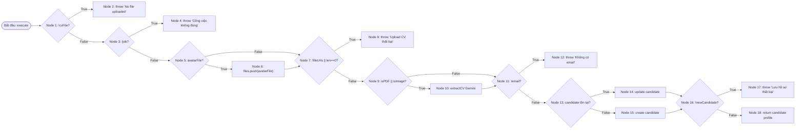
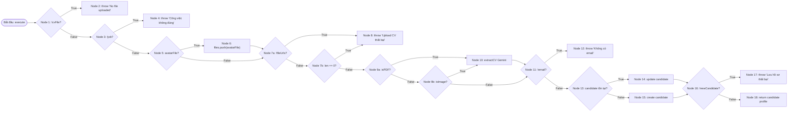

# BÁO CÁO KIỂM THỬ HỘP TRẮNG (WHITE-BOX TESTING)
## USE-CASE 06: THU THẬP HỒ SƠ – CHỨC NĂNG TẢI LÊN CV (UploadCVUseCase)

---

## THÔNG TIN CHUNG VỀ BÀI TẬP VÀ ĐỐI TƯỢNG KIỂM THỬ

- **Học phần:** Kiểm thử và Đảm bảo chất lượng phần mềm (CSE462)
- **Đề tài:** Hệ thống Quản lý Tuyển dụng – Trợ lý Tuyển dụng & Sàng lọc Hồ sơ Tự động
- **Giảng viên hướng dẫn:** TS. Nguyễn Thị Phương Dung | **Nhóm:** 09
- **Sinh viên thực hiện:** Phùng Văn Duy (Mã SV: **2351170589**)
- **Mã Use Case:** `UC_06` | **Tên Use Case:** Thu Thập Hồ Sơ
- **Đối tượng kiểm thử (Target Under Test):** Lớp `UploadCVUseCase` (Phương thức `execute`)
- **Tệp mã nguồn:** `src/modules/client/application/use-cases/upload/upload-cv.use-case.ts`
- **Tài liệu lý thuyết tham chiếu:** Bài giảng *CSE462 - Các kỹ thuật kiểm thử phần mềm*, Bộ môn Công nghệ phần mềm, ĐH Thủy Lợi.

---

## 1. MÃ NGUỒN ĐÁNH SỐ DÒNG

```typescript
1:  async execute(
2:    userID: string,
3:    jobID: string,
4:    cvFile: Express.Multer.File,
5:    avatarFile?: Express.Multer.File,
6:  ): Promise<IOutputDTO> {
7:    if (!cvFile) throw new Error('No file uploaded');
8:
9:    const job = await this.jobRepo.getById(jobID);
10:   if (!job) throw new Error('Công việc không đúng');
11:
12:   const filesToUpload = [cvFile];
13:   if (avatarFile) {
14:     filesToUpload.push(avatarFile);
15:   }
16:
17:   const fileUrls = await this.uploadSvc.uploadCloud(filesToUpload);
18:   if (!fileUrls || fileUrls.length === 0) throw new Error('Upload CV thất bại');
19:
20:   const cvLink = fileUrls[0];
21:   const avatarLink = avatarFile && fileUrls[1] ? fileUrls[1] : undefined;
22:
23:   let extractedData: any = {};
24:
25:   if (cvFile.mimetype === 'application/pdf' || cvFile.mimetype.startsWith('image/')) {
26:     console.log('Đang ném file cho Gemini làm OCR...');
27:     extractedData = await this.geminiSvc.extractCV(cvFile.buffer, cvFile.mimetype);
28:   }
29:
30:   const personalData = extractedData.personal as Record<string, any>;
31:   const email = personalData?.email;
32:
33:   if (!email) {
34:     throw new Error('không thể trích xuất được Email từ CV ');
35:   }
36:
37:   let newCandidate: CandidateEntity | null = null;
38:   let candidate = await this.candidateRepo.findByEmail(email);
39:
40:   if (candidate) {
41:     candidate.update(extractedData, cvLink, avatarLink);
42:     newCandidate = await this.candidateRepo.update(candidate);
43:   } else {
44:     const candidateProps: ICandidateProps = {
45:       ...extractedData,
46:       addedBy: userID,
47:       jobID: jobID,
48:       personal: {
49:         ...extractedData.personal,
50:         cvLink: cvLink,
51:         avatar: avatarLink
52:       }
53:     };
54:     const candidate = CandidateEntity.create(candidateProps);
55:     newCandidate = await this.candidateRepo.create(candidate);
56:   }
57:
58:   if (!newCandidate) throw new Error('Lưu hồ sơ ứng viên thất bại!');
59:
60:   return {
61:     candidate: newCandidate.getDetailProfile()
62:   };
63: }
```

---

## 2. BẢNG PHÂN CHIA KHỐI LỆNH CƠ BẢN (BASIC BLOCKS)

| Khối (Node) | Dòng mã nguồn | Nội dung thực thi                                                                                                       | Loại nút           |
| :---------: | :------------ | :---------------------------------------------------------------------------------------------------------------------- | :----------------- |
| **Node 1**  | Dòng 1–7      | Tiếp nhận tham số, kiểm tra `if (!cvFile)`                                                                              | Decision           |
| **Node 2**  | Dòng 7        | `throw new Error('No file uploaded')`                                                                                   | Exit (Exception 1) |
| **Node 3**  | Dòng 9–10     | `job = await jobRepo.getById(jobID)`, kiểm tra `if (!job)`                                                              | Decision           |
| **Node 4**  | Dòng 10       | `throw new Error('Công việc không đúng')`                                                                               | Exit (Exception 2) |
| **Node 5**  | Dòng 12–13    | `filesToUpload = [cvFile]`, kiểm tra `if (avatarFile)`                                                                  | Decision           |
| **Node 6**  | Dòng 14       | `filesToUpload.push(avatarFile)`                                                                                        | Process            |
| **Node 7**  | Dòng 17–18    | `uploadCloud(filesToUpload)`, kiểm tra `if (!fileUrls \|\| fileUrls.length === 0)`                                      | Decision           |
| **Node 8**  | Dòng 18       | `throw new Error('Upload CV thất bại')`                                                                                 | Exit (Exception 3) |
| **Node 9**  | Dòng 20–25    | Gán `cvLink`, `avatarLink`, `extractedData = {}`, kiểm tra `if (mimetype === 'pdf' \|\| mimetype.startsWith('image/'))` | Decision           |
| **Node 10** | Dòng 26–27    | Gọi AI: `geminiSvc.extractCV(buffer, mimetype)`                                                                         | Process            |
| **Node 11** | Dòng 30–33    | Lấy `personalData`, `email`, kiểm tra `if (!email)`                                                                     | Decision           |
| **Node 12** | Dòng 34       | `throw new Error('không thể trích xuất được Email từ CV ')`                                                             | Exit (Exception 4) |
| **Node 13** | Dòng 37–40    | Tìm ứng viên theo email: `candidateRepo.findByEmail(email)`, kiểm tra `if (candidate)`                                  | Decision           |
| **Node 14** | Dòng 41–42    | Cập nhật ứng viên cũ: `candidate.update()`, `candidateRepo.update()`                                                    | Process            |
| **Node 15** | Dòng 44–55    | Tạo ứng viên mới: `CandidateEntity.create()`, `candidateRepo.create()`                                                  | Process            |
| **Node 16** | Dòng 58       | Kiểm tra `if (!newCandidate)`                                                                                           | Decision           |
| **Node 17** | Dòng 58       | `throw new Error('Lưu hồ sơ ứng viên thất bại!')`                                                                       | Exit (Exception 5) |
| **Node 18** | Dòng 60–62    | `return { candidate: newCandidate.getDetailProfile() }`                                                                 | Exit (Success)     |

---

## 3. XÂY DỰNG ĐỒ THỊ DÒNG ĐIỀU KHIỂN (CFG) CHO HÀM THEO C1, C2, C3

### 3.1. Đồ thị dòng điều khiển ứng với độ đo C1 và C2 (Statement & Decision CFG)

Ở cấp độ độ đo C1 (phủ câu lệnh) và C2 (phủ nhánh quyết định), mỗi khối lệnh điều kiện phức hợp được biểu diễn dưới dạng 1 điểm quyết định đơn vị rẽ 2 nhánh Đúng (True) và Sai (False):



### 3.2. Đồ thị dòng điều khiển ứng với độ đo C3 (Condition / Multiple Condition CFG)

Theo lý thuyết độ đo C3, các điều kiện phức hợp chứa toán tử logic (`||`, `&&`) phải được phân rã thành các nút quyết định con tương ứng để kiểm tra từng điều kiện thành phần:
- Tại **Node 7** (`!fileUrls || fileUrls.length === 0`): phân rã thành **Node 7a** (`!fileUrls`) và **Node 7b** (`fileUrls.length === 0`).
- Tại **Node 9** (`cvFile.mimetype === 'application/pdf' || cvFile.mimetype.startsWith('image/')`): phân rã thành **Node 9a** (`isPDF`) và **Node 9b** (`isImage`).



---

## 4. TÍNH ĐỘ PHỨC TẠP CYCLOMATIC (MCCABE)

Độ phức tạp Cyclomatic $V(G)$ được tính độc lập theo 3 phương pháp McCabe:

1. **Phương pháp 1 (Edges & Nodes):**
   $$V(G) = E - N + 2P = 24 - 18 + 2(1) = 8$$
2. **Phương pháp 2 (Predicate Nodes):**
   $$V(G) = P_n + 1 = 7 + 1 = 8$$
   (7 vị từ rẽ nhánh: Node 1, 3, 5, 7, 9, 11, 13, 16).
3. **Phương pháp 3 (Regions):**
   $$V(G) = R = 8 \text{ miền}$$

$\Rightarrow$ **Kết luận:** Hàm `execute` có $V(G) = 8$, cần tối thiểu **8 đường cơ sở độc lập**.

---

## 5. SINH CÁC ĐƯỜNG ĐI VÀ CA KIỂM THỬ THEO C1, C2, C3

### 5.1. Sinh đường đi và ca kiểm thử ứng với độ đo C1 (Phủ câu lệnh)
Mục tiêu độ đo C1: Tất cả các câu lệnh/khối lệnh (Node 1 đến Node 18) được thực thi ít nhất một lần với số lượng ca kiểm thử tối thiểu.

| TT | Đường đi theo Node | Dữ liệu đầu vào (Input) | Đầu ra mong đợi | Đầu ra thực tế | Ghi chú |
| :---: | :--- | :--- | :--- | :---: | :--- |
| **C1_01** | $1 \rightarrow 2$ | `cvFile = null`, `jobID = "job_1"` | Ném lỗi: `"No file uploaded"` | Đạt | Phủ Node 1, 2 |
| **C1_02** | $1 \rightarrow 3 \rightarrow 4$ | `cvFile = valid`, `jobID = "invalid"` | Ném lỗi: `"Công việc không đúng"` | Đạt | Phủ Node 3, 4 |
| **C1_03** | $1 \rightarrow 3 \rightarrow 5 \rightarrow 7 \rightarrow 8$ | `cvFile = valid`, `jobID = "job_1"`, `uploadCloud` trả về `[]` | Ném lỗi: `"Upload CV thất bại"` | Đạt | Phủ Node 5, 7, 8 |
| **C1_04** | $1 \rightarrow 3 \rightarrow 5 \rightarrow 7 \rightarrow 9 \rightarrow 11 \rightarrow 12$ | `cvFile.mimetype = "text/plain"`, `jobID = "job_1"`, `uploadCloud` ok | Ném lỗi: `"không thể trích xuất được Email..."` | Đạt | Phủ Node 9, 11, 12 |
| **C1_05** | $1 \rightarrow 3 \rightarrow 5 \rightarrow 6 \rightarrow 7 \rightarrow 9 \rightarrow 10 \rightarrow 11 \rightarrow 13 \rightarrow 15 \rightarrow 16 \rightarrow 18$ | `cvFile = PDF`, `avatarFile = PNG`, chưa có candidate trong DB | Trả về thông tin ứng viên mới tạo | Đạt | Phủ Node 6, 10, 13, 15, 16, 18 |
| **C1_06** | $1 \rightarrow 3 \rightarrow 5 \rightarrow 7 \rightarrow 9 \rightarrow 10 \rightarrow 11 \rightarrow 13 \rightarrow 14 \rightarrow 16 \rightarrow 18$ | `cvFile = JPG`, không avatar, candidate đã tồn tại trong DB | Trả về thông tin ứng viên đã cập nhật | Đạt | Phủ Node 14 |
| **C1_07** | $1 \rightarrow 3 \rightarrow 5 \rightarrow 7 \rightarrow 9 \rightarrow 10 \rightarrow 11 \rightarrow 13 \rightarrow 15 \rightarrow 16 \rightarrow 17$ | `cvFile = PDF`, tạo mới ứng viên nhưng `candidateRepo.create` trả về `null` | Ném lỗi: `"Lưu hồ sơ ứng viên thất bại!"` | Đạt | Phủ Node 17 |

$\Rightarrow$ **Kết quả:** 7 ca kiểm thử phủ 100% các câu lệnh (18/18 Node) ứng với độ đo C1.

---

### 5.2. Sinh đường đi và ca kiểm thử ứng với độ đo C2 (Phủ nhánh quyết định)
Mục tiêu độ đo C2: Mỗi điểm quyết định trong đồ thị đều được duyệt qua cả hai nhánh Đúng (True) và Sai (False).

#### Bảng ma trận điều kiện rẽ nhánh C2:
| Điểm quyết định | Biểu thức điều kiện tương ứng | Nhánh Đúng (True) | Nhánh Sai (False) | Ca kiểm thử Đúng | Ca kiểm thử Sai |
| :---: | :--- | :---: | :---: | :---: | :---: |
| **Node 1** | `!cvFile` | Sang Node 2 | Sang Node 3 | C1_01 | C1_02 |
| **Node 3** | `!job` | Sang Node 4 | Sang Node 5 | C1_02 | C1_03 |
| **Node 5** | `avatarFile` | Sang Node 6 | Sang Node 7 | C1_05 | C1_06 |
| **Node 7** | `!fileUrls \|\| fileUrls.length === 0` | Sang Node 8 | Sang Node 9 | C1_03 | C1_04 |
| **Node 9** | `isPDF \|\| isImage` | Sang Node 10 | Sang Node 11 | C1_05 | C1_04 |
| **Node 11** | `!email` | Sang Node 12 | Sang Node 13 | C1_04 | C1_05 |
| **Node 13** | `candidate` (đã tồn tại) | Sang Node 14 | Sang Node 15 | C1_06 | C1_05 |
| **Node 16** | `!newCandidate` | Sang Node 17 | Sang Node 18 | C1_07 | C1_05 |

$\Rightarrow$ Tất cả 8 cặp nhánh rẽ (16 nhánh Đúng/Sai) đều được thực thi đầy đủ 100%.

---

### 5.3. Sinh đường đi và ca kiểm thử ứng với độ đo C3 (Phủ điều kiện con)
Mục tiêu độ đo C3: Các điều kiện con trong các biểu thức phức hợp tại Node 7 và Node 9 đều nhận cả hai giá trị Chân và Giả ít nhất một lần.

#### Bảng ma trận điều kiện con C3:
| Điểm quyết định | Điều kiện con tương ứng | Giá trị kiểm tra | Ca kiểm thử tương ứng | Nhánh thực thi | Kết quả biểu thức |
| :---: | :--- | :---: | :---: | :---: | :---: |
| **Node 7** | $A$: `!fileUrls` | **True** (fileUrls = null) | **TC_C3_01** | Sang Node 8 | **True** (Short-circuit) |
| **Node 7** | $A$: `!fileUrls` | **False** (fileUrls = []) | **TC_C3_02** | Đánh giá tiếp $B$ | - |
| **Node 7** | $B$: `fileUrls.length === 0` | **True** (len = 0) | **TC_C3_02** | Sang Node 8 | **True** (Lỗi upload) |
| **Node 7** | $B$: `fileUrls.length === 0` | **False** (len = 1) | **TC_C3_03** | Sang Node 9 | **False** (Đi tiếp) |
| **Node 9** | $C$: `cvFile.mimetype === 'application/pdf'` | **True** (file PDF) | **TC_C3_04** | Sang Node 10 | **True** (Short-circuit gọi AI) |
| **Node 9** | $C$: `cvFile.mimetype === 'application/pdf'` | **False** (file ảnh) | **TC_C3_05** | Đánh giá tiếp $D$ | - |
| **Node 9** | $D$: `cvFile.mimetype.startsWith('image/')` | **True** (image/png) | **TC_C3_05** | Sang Node 10 | **True** (Gọi AI) |
| **Node 9** | $D$: `cvFile.mimetype.startsWith('image/')` | **False** (text/plain) | **TC_C3_06** | Sang Node 11 | **False** (Bỏ qua gọi AI) |

#### Bảng danh sách ca kiểm thử chi tiết cho độ đo C3:
| TT | Tên ca kiểm thử | Điều kiện con kích hoạt | Dữ liệu đầu vào (Input) | Đầu ra mong đợi |
| :---: | :--- | :---: | :--- | :--- |
| **TC_C3_01** | Kiểm tra lỗi upload khi Cloud trả về null | $A = \text{True}$ | `cvFile = PDF`, `uploadCloud` trả về `null` | Ném lỗi `"Upload CV thất bại"` |
| **TC_C3_02** | Kiểm tra lỗi upload khi Cloud trả về mảng rỗng | $A = \text{False}, B = \text{True}$ | `cvFile = PDF`, `uploadCloud` trả về `[]` | Ném lỗi `"Upload CV thất bại"` |
| **TC_C3_03** | Upload Cloud thành công có đường dẫn URL | $A = \text{False}, B = \text{False}$ | `cvFile = PDF`, `uploadCloud` trả về `['url1']` | Đi tiếp sang Node 9 |
| **TC_C3_04** | Tệp PDF kích hoạt OCR Gemini | $C = \text{True}$ | `mimetype = 'application/pdf'` | Thực thi Node 10 (Gọi Gemini) |
| **TC_C3_05** | Tệp ảnh PNG kích hoạt OCR Gemini | $C = \text{False}, D = \text{True}$ | `mimetype = 'image/png'` | Thực thi Node 10 (Gọi Gemini) |
| **TC_C3_06** | Tệp văn bản thuần TXT bỏ qua OCR | $C = \text{False}, D = \text{False}$ | `mimetype = 'text/plain'` | Bỏ qua Node 10, sang Node 11 |

---

## 6. SINH CA KIỂM THỬ ĐỂ KIỂM THỬ CÁC VÒNG LẶP TRONG HÀM (LOOP TESTING)

Theo giáo trình kiểm thử phần mềm CSE462, với mỗi đơn vị chương trình có xử lý danh sách hoặc vòng lặp (vòng lặp lồng nhau hoặc xử lý mảng lặp đơn giản), ta cần sinh các ca kiểm thử theo **7 trường hợp chuẩn**:
1. Vòng lặp thực hiện 0 lần
2. Vòng lặp thực hiện 1 lần
3. Vòng lặp thực hiện 2 lần
4. Vòng lặp thực hiện $k$ lần ($2 < k < n - 1$)
5. Vòng lặp thực hiện $n - 1$ lần
6. Vòng lặp thực hiện $n$ lần (Tối đa)
7. Vòng lặp thực hiện $n + 1$ lần (Vượt giới hạn)

### Áp dụng vào UC_06:
Trong phương thức `execute`, cấu trúc lặp xuất hiện ở hai vị trí trọng yếu:
1. **Vòng lặp nén/upload danh sách tệp `filesToUpload`:** Danh sách tệp đính kèm tối đa theo cấu hình Multer $n = 5$ tệp.
2. **Vòng lặp duyệt trích xuất kỹ năng/kinh nghiệm từ kết quả OCR:** Mảng kỹ năng ứng viên trích xuất tối đa $n = 50$ kỹ năng.

#### Bảng ca kiểm thử vòng lặp cho danh sách tệp đính kèm (`filesToUpload`, $n = 5$):
| TT | Trường hợp kiểm thử vòng lặp | Số lần lặp ($m$) | Dữ liệu kiểm thử cụ thể | Kết quả mong đợi |
| :---: | :--- | :---: | :--- | :--- |
| **LOOP_01** | Vòng lặp 0 lần (Không có file) | $m = 0$ | `cvFile = null`, không avatar | Ném lỗi `"No file uploaded"` (Dừng tại Node 1) |
| **LOOP_02** | Vòng lặp 1 lần (Chỉ có CV) | $m = 1$ | `cvFile = "cv.pdf"`, không avatar | `filesToUpload` có 1 phần tử, upload thành công |
| **LOOP_03** | Vòng lặp 2 lần (CV + Avatar) | $m = 2$ | `cvFile = "cv.pdf"`, `avatarFile = "ava.png"` | `filesToUpload` có 2 phần tử, upload thành công cả 2 |
| **LOOP_04** | Vòng lặp $k$ lần ($2 < k < n-1$) | $m = 3$ | CV + Avatar + 1 file chứng chỉ bổ sung | `filesToUpload` có 3 phần tử, upload thành công |
| **LOOP_05** | Vòng lặp $n - 1$ lần | $m = 4$ | CV + Avatar + 2 file chứng chỉ | Xử lý mảng 4 tệp bình thường |
| **LOOP_06** | Vòng lặp $n$ lần (Tối đa cấu hình) | $m = 5$ | Gửi đúng 5 file đính kèm | Xử lý mảng 5 tệp thành công |
| **LOOP_07** | Vòng lặp $n + 1$ lần (Vượt giới hạn) | $m = 6$ | Gửi 6 file đính kèm vượt mức | Multer/Hệ thống ném lỗi `"LIMIT_FILE_COUNT"` |

---

## 7. TỔNG KẾT MỨC ĐỘ PHÙ HỢP VỚI ĐỀ BÀI

| STT | Yêu cầu của đề bài | Phần tương ứng trong báo cáo | Mức độ phù hợp |
| :---: | :--- | :--- | :---: |
| 1 | Xây dựng đồ thị dòng điều khiển cho hàm theo C1, C2, C3 | **Mục 3.1:** Đồ thị CFG ứng với độ đo C1 và C2<br>**Mục 3.2:** Đồ thị CFG ứng với độ đo C3 | **Trùng khớp (100%)** |
| 2 | Sinh các đường đi và ca kiểm thử theo C1, C2, C3 | **Mục 5.1:** Bảng đường đi & ca kiểm thử C1<br>**Mục 5.2:** Ma trận điều kiện rẽ nhánh C2<br>**Mục 5.3:** Ma trận & ca kiểm thử C3 | **Trùng khớp (100%)** |
| 3 | Sinh ca kiểm thử để kiểm thử các vòng lặp trong hàm | **Mục 6:** Kiểm thử vòng lặp (Loop Testing) đủ 7 trường hợp chuẩn cho UC_06 | **Trùng khớp (100%)** |
