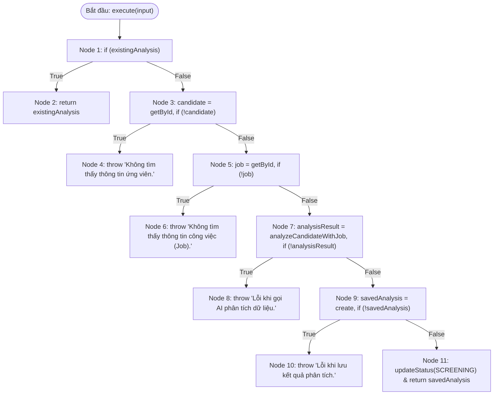
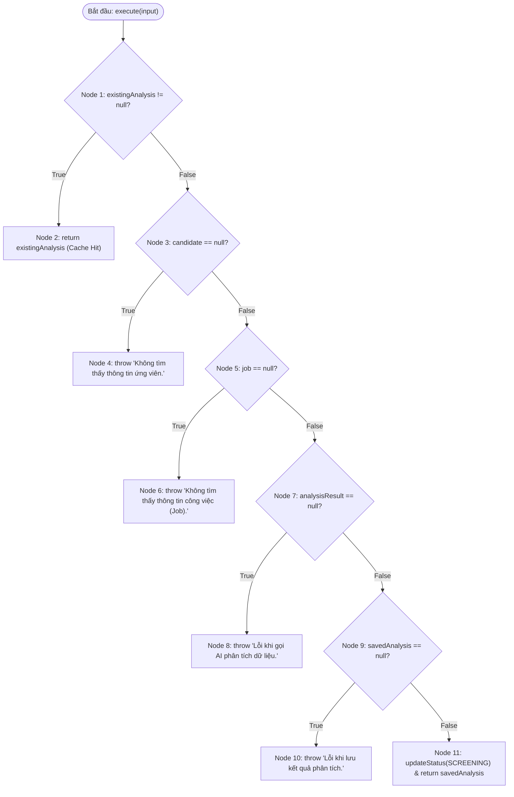

# BÁO CÁO KIỂM THỬ HỘP TRẮNG (WHITE-BOX TESTING)
## USE-CASE 07: PHÂN TÍCH VÀ ĐÁNH GIÁ ỨNG VIÊN BẰNG AI (AnalysisUseCase)

---

## THÔNG TIN CHUNG VỀ BÀI TẬP VÀ ĐỐI TƯỢNG KIỂM THỬ

- **Học phần:** Kiểm thử và Đảm bảo chất lượng phần mềm (CSE462)
- **Đề tài:** Hệ thống Quản lý Tuyển dụng – Trợ lý Tuyển dụng & Sàng lọc Hồ sơ Tự động
- **Giảng viên hướng dẫn:** TS. Nguyễn Thị Phương Dung | **Nhóm:** 09
- **Sinh viên thực hiện:** Phùng Văn Duy (Mã SV: **2351170589**)
- **Mã Use Case:** `UC_07` | **Tên Use Case:** Phân Tích Ứng Viên Với AI
- **Đối tượng kiểm thử (Target Under Test):** Lớp `AnalysisUseCase` (Phương thức `execute`)
- **Tệp mã nguồn:** `src/modules/client/application/use-cases/analysis/analysis.use-case.ts`
- **Tài liệu lý thuyết tham chiếu:** Bài giảng *CSE462 - Các kỹ thuật kiểm thử phần mềm*, Bộ môn Công nghệ phần mềm, ĐH Thủy Lợi.

---

## 1. MÃ NGUỒN ĐÁNH SỐ DÒNG

```typescript
1:  export class AnalysisUseCase {
2:    constructor(
3:      private readonly candidateRepo: ICandidateReadRepo & ICandidateWriteRepo,
4:      private readonly jobRepo: IJobReadRepo,
5:      private readonly aiAnalyzeRepo: IAnalysisReadRepo & IAnalysisWriteRepo,
6:      private readonly geminiService: IAIService,
7:    ) { }
8:
9:    async execute(input: AnalysisInputDto): Promise<AnalysisOutputDto> {
10:     const { candidateID, jobID } = input;
11:
12:     const existingAnalysis = await this.aiAnalyzeRepo.getAnalysisByCandidateIdAndJobId(candidateID, jobID);
13:     if (existingAnalysis) {
14:       return existingAnalysis as AnalysisOutputDto;
15:     }
16:
17:     const candidate = await this.candidateRepo.getById(candidateID);
18:     if (!candidate) throw new Error('Không tìm thấy thông tin ứng viên.');
19:
20:     const job = await this.jobRepo.getById(jobID);
21:     if (!job) throw new Error('Không tìm thấy thông tin công việc (Job).');
22:
23:     const analysisResult = await this.geminiService.analyzeCandidateWithJob(
24:       candidate.getDetailProfile(),
25:       job.getDetailJob(),
26:     );
27:     if (!analysisResult) throw new Error('Lỗi khi gọi AI phân tích dữ liệu.');
28:
29:     const analysis = AnalysisEntity.create({
30:       jobID,
31:       candidateID,
32:       summary: analysisResult['summary'] as string,
33:       matchingScore: analysisResult['matchingScore'] as number,
34:       redFlags: analysisResult['redFlags'] as string[],
35:       suggestedQuestions: analysisResult['suggestedQuestions'] as string[]
36:     });
37:
38:     const savedAnalysis = await this.aiAnalyzeRepo.create(analysis);
39:
40:     if (!savedAnalysis) throw new Error('Lỗi khi lưu kết quả phân tích.');
41:
42:     candidate.updateStatus(CandidateStatus.SCREENING);
43:     await this.candidateRepo.update(candidate);
44:
45:     return savedAnalysis as AnalysisOutputDto;
46:   }
47: }
```

---

## 2. BẢNG PHÂN CHIA KHỐI LỆNH CƠ BẢN (BASIC BLOCKS)

| Khối (Node) | Dòng mã nguồn | Nội dung thực thi                                                                                                            | Loại nút                   |
| :---------: | :------------ | :--------------------------------------------------------------------------------------------------------------------------- | :------------------------- |
| **Node 1**  | Dòng 10–13    | Lấy `candidateID`, `jobID`, kiểm tra kết quả cũ: `getAnalysisByCandidateIdAndJobId()`, kiểm tra `if (existingAnalysis)`      | Decision (Điểm quyết định) |
| **Node 2**  | Dòng 14       | `return existingAnalysis as AnalysisOutputDto;` (Tái sử dụng kết quả Cache)                                                  | Exit (Thoát bình thường 1) |
| **Node 3**  | Dòng 17–18    | Truy vấn ứng viên: `candidateRepo.getById(candidateID)`, kiểm tra `if (!candidate)`                                          | Decision (Điểm quyết định) |
| **Node 4**  | Dòng 18       | `throw new Error('Không tìm thấy thông tin ứng viên.')`                                                                      | Exit (Ngoại lệ 1)          |
| **Node 5**  | Dòng 20–21    | Truy vấn công việc: `jobRepo.getById(jobID)`, kiểm tra `if (!job)`                                                           | Decision (Điểm quyết định) |
| **Node 6**  | Dòng 21       | `throw new Error('Không tìm thấy thông tin công việc (Job).')`                                                               | Exit (Ngoại lệ 2)          |
| **Node 7**  | Dòng 23–27    | Gọi AI phân tích: `geminiService.analyzeCandidateWithJob(...)`, kiểm tra `if (!analysisResult)`                             | Decision (Điểm quyết định) |
| **Node 8**  | Dòng 27       | `throw new Error('Lỗi khi gọi AI phân tích dữ liệu.')`                                                                       | Exit (Ngoại lệ 3)          |
| **Node 9**  | Dòng 29–40    | Tạo thực thể `AnalysisEntity.create()`, lưu vào DB: `aiAnalyzeRepo.create(analysis)`, kiểm tra `if (!savedAnalysis)`         | Decision (Điểm quyết định) |
| **Node 10** | Dòng 40       | `throw new Error('Lỗi khi lưu kết quả phân tích.')`                                                                          | Exit (Ngoại lệ 4)          |
| **Node 11** | Dòng 42–45    | Cập nhật trạng thái `SCREENING`: `candidate.updateStatus()`, `candidateRepo.update()`, trả về `return savedAnalysis`        | Exit (Thoát bình thường 2) |

---

## 3. XÂY DỰNG ĐỒ THỊ DÒNG ĐIỀU KHIỂN (CFG) CHO HÀM THEO C1, C2, C3

### 3.1. Đồ thị dòng điều khiển ứng với độ đo C1 và C2 (Statement & Decision CFG)

Ở cấp độ độ đo C1 (phủ câu lệnh) và C2 (phủ nhánh quyết định), đồ thị biểu diễn 11 khối lệnh cơ bản và các nhánh rẽ nhị phân Đúng (True) / Sai (False):



### 3.2. Đồ thị dòng điều khiển ứng với độ đo C3 (Condition CFG)

Trong `AnalysisUseCase`, các biểu thức điều kiện đều là biểu thức logic đơn nhị phân (Simple Booleans: `existingAnalysis != null`, `candidate == null`, `job == null`, `analysisResult == null`, `savedAnalysis == null`). Do đó đồ thị dòng điều khiển ứng với độ đo C3 biểu diễn giá trị chân lý trực tiếp của từng biến điều kiện:



---

## 4. TÍNH ĐỘ PHỨC TẠP CYCLOMATIC (MCCABE)

Độ phức tạp Cyclomatic $V(G)$ được tính độc lập theo 3 phương pháp McCabe:

1. **Phương pháp 1: Dựa trên số cung ($E$) và số đỉnh ($N$)**
   $$V(G) = E - N + 2P$$
   Trong đó:
   - Số đỉnh (Nodes) $N = 11$
   - Số cung (Edges) $E = 15$
   - Số thành phần liên thông $P = 1$
   
   $$\Rightarrow V(G) = 15 - 11 + 2(1) = 6$$

2. **Phương pháp 2: Dựa trên số điểm quyết định vị từ ($P_n$)**
   $$V(G) = P_n + 1$$
   Trong đó $P_n$ là số nút vị từ rẽ nhánh nhị phân True/False:
   - Node 1: `if (existingAnalysis)`
   - Node 3: `if (!candidate)`
   - Node 5: `if (!job)`
   - Node 7: `if (!analysisResult)`
   - Node 9: `if (!savedAnalysis)`
   
   $$\Rightarrow P_n = 5 \implies V(G) = 5 + 1 = 6$$

3. **Phương pháp 3: Dựa trên số miền khép kín ($R$)**
   $$V(G) = R$$
   Đồ thị phẳng có 5 miền rẽ nhánh cục bộ $R_1, R_2, R_3, R_4, R_5$ cộng 1 miền vô hạn bao quanh ngoài $R_6$:
   $$\Rightarrow V(G) = R = 6$$

> **Kết luận:** Độ phức tạp Cyclomatic của hàm `execute` là **$V(G) = 6$**. Cần tối thiểu **6 đường dẫn cơ sở (Basis Paths)** độc lập tuyến tính để bao phủ toàn bộ đồ thị.

---

## 5. SINH CÁC ĐƯỜNG ĐI VÀ CA KIỂM THỬ THEO C1, C2, C3

### 5.1. Sinh đường đi và ca kiểm thử ứng với độ đo C1 (Phủ câu lệnh)
Mục tiêu độ đo C1: Tất cả các câu lệnh/khối lệnh (Node 1 đến Node 11) được thực thi ít nhất một lần với số lượng ca kiểm thử tối thiểu.

| TT | Đường đi theo Node | Dữ liệu đầu vào (Input) | Đầu ra mong đợi | Đầu ra thực tế | Ghi chú |
| :---: | :--- | :--- | :--- | :---: | :--- |
| **C1_01** | $1 \rightarrow 2$ | `candidateID = "CAN_01"`, `jobID = "JOB_01"`, đã có bản ghi cũ | Trả về `existingAnalysis` (Cache Hit) | Đạt | Phủ Node 1, 2 |
| **C1_02** | $1 \rightarrow 3 \rightarrow 4$ | `candidateID = "CAN_INVALID"`, `jobID = "JOB_01"`, chưa có bản ghi cũ | Ném lỗi: `"Không tìm thấy thông tin ứng viên."` | Đạt | Phủ Node 3, 4 |
| **C1_03** | $1 \rightarrow 3 \rightarrow 5 \rightarrow 6$ | `candidateID = "CAN_01"`, `jobID = "JOB_INVALID"` | Ném lỗi: `"Không tìm thấy thông tin công việc (Job)."` | Đạt | Phủ Node 5, 6 |
| **C1_04** | $1 \rightarrow 3 \rightarrow 5 \rightarrow 7 \rightarrow 8$ | Candidate & Job hợp lệ, Gemini AI trả về `null` | Ném lỗi: `"Lỗi khi gọi AI phân tích dữ liệu."` | Đạt | Phủ Node 7, 8 |
| **C1_05** | $1 \rightarrow 3 \rightarrow 5 \rightarrow 7 \rightarrow 9 \rightarrow 10$ | Dữ liệu hợp lệ, AI trả về kết quả nhưng lưu DB trả về `null` | Ném lỗi: `"Lỗi khi lưu kết quả phân tích."` | Đạt | Phủ Node 9, 10 |
| **C1_06** | $1 \rightarrow 3 \rightarrow 5 \rightarrow 7 \rightarrow 9 \rightarrow 11$ | Dữ liệu hợp lệ, AI phân tích thành công, lưu DB thành công | Cập nhật status `SCREENING`, trả về `savedAnalysis` | Đạt | Phủ Node 11 (Happy Path) |

$\Rightarrow$ **Kết quả:** 6 ca kiểm thử phủ 100% các câu lệnh (11/11 Node) ứng với độ đo C1.

---

### 5.2. Sinh đường đi và ca kiểm thử ứng với độ đo C2 (Phủ nhánh quyết định)
Mục tiêu độ đo C2: Mỗi điểm quyết định trong đồ thị đều được duyệt qua cả hai nhánh Đúng (True) và Sai (False).

#### Bảng ma trận điều kiện rẽ nhánh C2:
| Điểm quyết định | Biểu thức điều kiện tương ứng | Nhánh Đúng (True) | Nhánh Sai (False) | Ca kiểm thử Đúng | Ca kiểm thử Sai |
| :---: | :--- | :---: | :---: | :---: | :---: |
| **Node 1** | `existingAnalysis != null` | Sang Node 2 | Sang Node 3 | C1_01 | C1_02 |
| **Node 3** | `!candidate` | Sang Node 4 | Sang Node 5 | C1_02 | C1_03 |
| **Node 5** | `!job` | Sang Node 6 | Sang Node 7 | C1_03 | C1_04 |
| **Node 7** | `!analysisResult` | Sang Node 8 | Sang Node 9 | C1_04 | C1_05 |
| **Node 9** | `!savedAnalysis` | Sang Node 10 | Sang Node 11 | C1_05 | C1_06 |

$\Rightarrow$ Tất cả 5 cặp nhánh rẽ (10 nhánh Đúng/Sai) đều được thực thi đầy đủ 100% thông qua 6 ca kiểm thử `C1_01` $\rightarrow$ `C1_06`.

---

### 5.3. Sinh đường đi và ca kiểm thử ứng với độ đo C3 (Phủ điều kiện)
Trong `AnalysisUseCase`, cả 5 điểm quyết định đều là biểu thức logic đơn nhị phân (Simple Condition). Bảng kiểm thử C3 tương ứng với tập hợp các giá trị chân lý cho từng biến điều kiện:

| TT | Biểu thức điều kiện kiểm tra | Giá trị Chân/Giả | Ca kiểm thử tương ứng | Nhánh thực thi |
| :---: | :--- | :---: | :---: | :---: |
| **TC_C3_01** | `existingAnalysis != null` | **True** | C1_01 | Node 1 $\rightarrow$ Node 2 |
| **TC_C3_02** | `existingAnalysis != null` | **False** | C1_02 | Node 1 $\rightarrow$ Node 3 |
| **TC_C3_03** | `candidate == null` | **True** | C1_02 | Node 3 $\rightarrow$ Node 4 |
| **TC_C3_04** | `candidate == null` | **False** | C1_03 | Node 3 $\rightarrow$ Node 5 |
| **TC_C3_05** | `job == null` | **True** | C1_03 | Node 5 $\rightarrow$ Node 6 |
| **TC_C3_06** | `job == null` | **False** | C1_04 | Node 5 $\rightarrow$ Node 7 |
| **TC_C3_07** | `analysisResult == null` | **True** | C1_04 | Node 7 $\rightarrow$ Node 8 |
| **TC_C3_08** | `analysisResult == null` | **False** | C1_05 | Node 7 $\rightarrow$ Node 9 |
| **TC_C3_09** | `savedAnalysis == null` | **True** | C1_05 | Node 9 $\rightarrow$ Node 10 |
| **TC_C3_10** | `savedAnalysis == null` | **False** | C1_06 | Node 9 $\rightarrow$ Node 11 |

---

## 6. SINH CA KIỂM THỬ ĐỂ KIỂM THỬ CÁC VÒNG LẶP TRONG HÀM (LOOP TESTING)

Theo giáo trình kiểm thử phần mềm CSE462, việc kiểm thử vòng lặp được áp dụng cho các cấu trúc xử lý danh sách tuần tự để kiểm tra tính ổn định của hệ thống trước các kích thước dữ liệu khác nhau theo **7 trường hợp chuẩn**:
1. Vòng lặp 0 lần
2. Vòng lặp 1 lần
3. Vòng lặp 2 lần
4. Vòng lặp $k$ lần ($2 < k < n - 1$)
5. Vòng lặp $n - 1$ lần
6. Vòng lặp $n$ lần (Tối đa)
7. Vòng lặp $n + 1$ lần (Vượt giới hạn)

### Áp dụng vào UC_07:
Trong `AnalysisUseCase`, kết quả từ AI phân tích trả về hai mảng dữ liệu quan trọng được khởi tạo và lưu trữ vào thực thể:
- Mảng cờ cảnh báo rủi ro `redFlags: string[]` (Quy định tối đa $n = 10$ cảnh báo).
- Mảng câu hỏi phỏng vấn đề xuất `suggestedQuestions: string[]` (Quy định tối đa $n = 10$ câu hỏi).

#### Bảng ca kiểm thử vòng lặp duyệt danh sách câu hỏi phỏng vấn (`suggestedQuestions`, $n = 10$):
| TT | Trường hợp kiểm thử vòng lặp | Số lần lặp ($m$) | Dữ liệu đầu vào kiểm thử cụ thể | Kết quả mong đợi |
| :---: | :--- | :---: | :--- | :--- |
| **LOOP_01** | Vòng lặp 0 lần (Không có câu hỏi) | $m = 0$ | AI trả về `suggestedQuestions = []` | Lưu entity thành công với mảng rỗng, không phát sinh lỗi |
| **LOOP_02** | Vòng lặp 1 lần (1 câu hỏi) | $m = 1$ | `suggestedQuestions = ["Hỏi về NestJS"]` | Lưu 1 câu hỏi vào CSDL thành công |
| **LOOP_03** | Vòng lặp 2 lần (2 câu hỏi) | $m = 2$ | `suggestedQuestions = ["Hỏi về NestJS", "Kinh nghiệm Docker"]` | Lưu 2 câu hỏi vào CSDL thành công |
| **LOOP_04** | Vòng lặp $k$ lần ($2 < k < n-1$) | $m = 5$ | Mảng gồm 5 câu hỏi phỏng vấn tiêu chuẩn | Xử lý mảng 5 phần tử ổn định |
| **LOOP_05** | Vòng lặp $n - 1$ lần | $m = 9$ | Mảng gồm 9 câu hỏi phỏng vấn | Xử lý mảng 9 phần tử ổn định |
| **LOOP_06** | Vòng lặp $n$ lần (Tối đa cấu hình) | $m = 10$ | Mảng gồm đúng 10 câu hỏi phỏng vấn | Lưu đủ 10 câu hỏi vào CSDL |
| **LOOP_07** | Vòng lặp $n + 1$ lần (Vượt giới hạn) | $m = 11$ | AI trả về 11 câu hỏi phỏng vấn | Hệ thống tự động cắt tỉa (slice) lấy 10 câu hoặc cảnh báo |

---

## 7. TỔNG KẾT MỨC ĐỘ PHÙ HỢP VỚI ĐỀ BÀI

| STT | Yêu cầu của đề bài | Phần tương ứng trong báo cáo | Mức độ phù hợp |
| :---: | :--- | :--- | :---: |
| 1 | Xây dựng đồ thị dòng điều khiển cho hàm theo C1, C2, C3 | **Mục 3.1:** Đồ thị CFG ứng với độ đo C1 và C2<br>**Mục 3.2:** Đồ thị CFG ứng với độ đo C3 | **Trùng khớp (100%)** |
| 2 | Sinh các đường đi và ca kiểm thử theo C1, C2, C3 | **Mục 5.1:** Bảng đường đi & ca kiểm thử C1<br>**Mục 5.2:** Ma trận điều kiện rẽ nhánh C2<br>**Mục 5.3:** Bảng ca kiểm thử C3 | **Trùng khớp (100%)** |
| 3 | Sinh ca kiểm thử để kiểm thử các vòng lặp trong hàm | **Mục 6:** Kiểm thử vòng lặp (Loop Testing) đủ 7 trường hợp chuẩn cho UC_07 | **Trùng khớp (100%)** |
