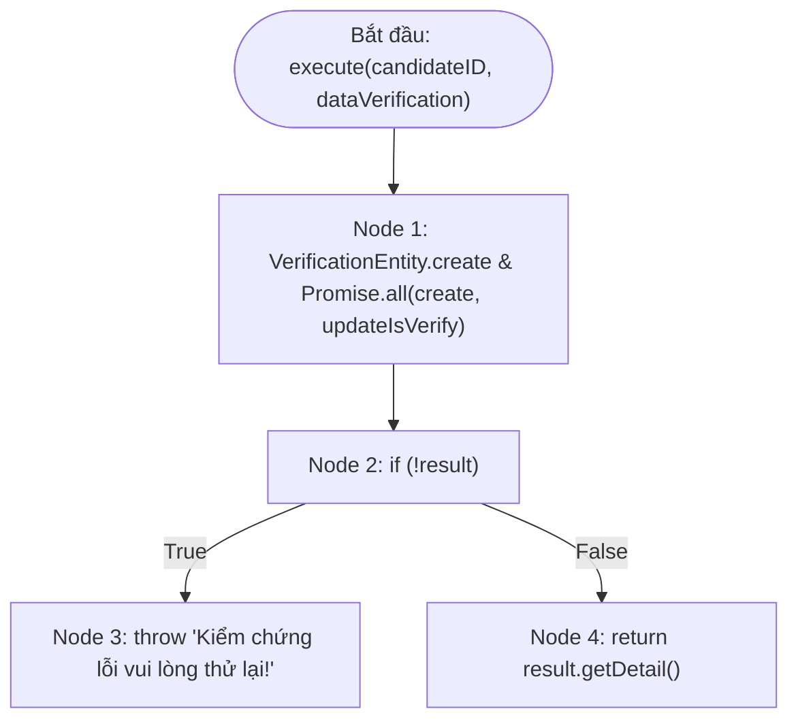
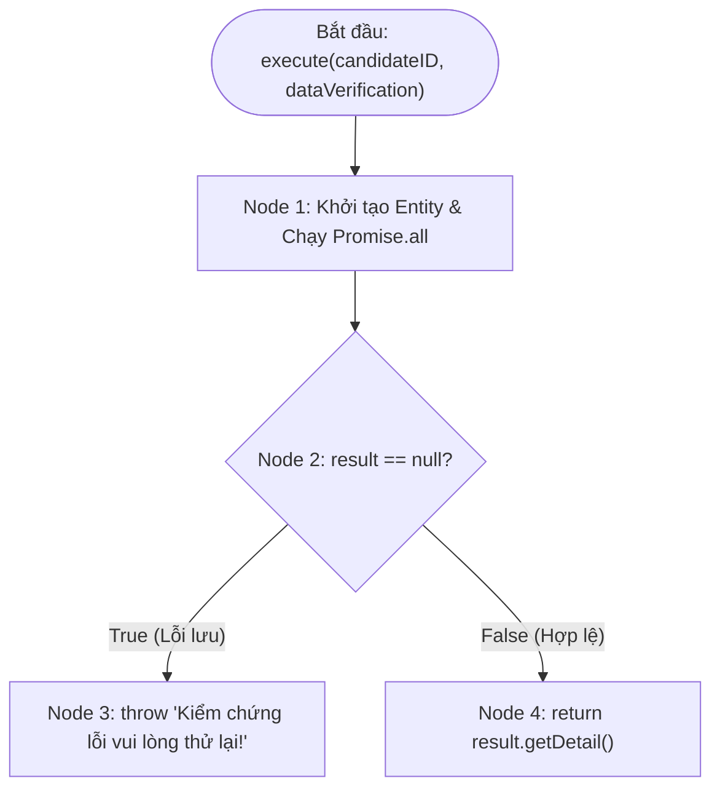
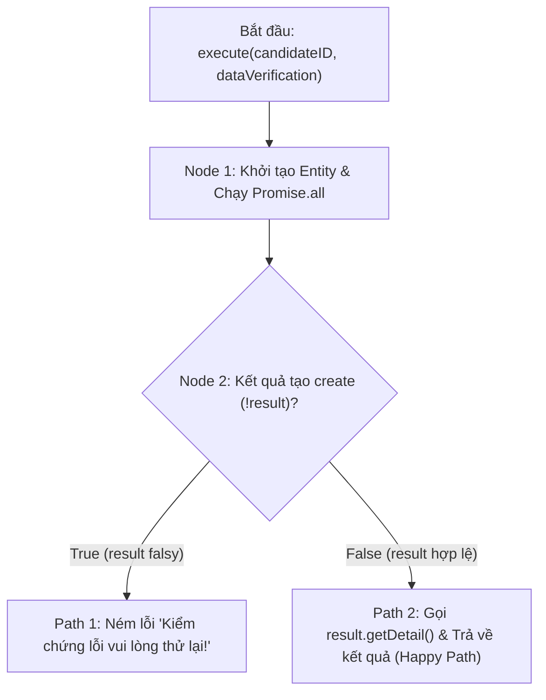
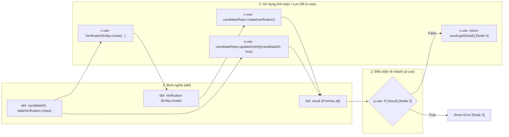

# BÁO CÁO KIỂM THỬ HỘP TRẮNG (WHITE-BOX TESTING)

## USE CASE 08: XÁC THỰC THÔNG TIN ỨNG VIÊN (VerifyCandidateUseCase)

---

### THÔNG TIN CHUNG VỀ BÀI TẬP VÀ ĐỐI TƯỢNG KIỂM THỬ

- **Học phần:** Kiểm thử và Đảm bảo chất lượng phần mềm (CSE462)
- **Học kỳ:** Học kỳ 7 – Năm học 2025–2026
- **Giảng viên hướng dẫn:** TS. Nguyễn Thị Phương Dung
- **Sinh viên thực hiện:** Phùng Văn Duy
- **Mã số sinh viên (MSSV):** 2351170589
- **Nhóm thực hiện:** Nhóm 09
- **Đề tài:** Hệ thống Quản lý Tuyển dụng – Trợ lý Tuyển dụng & Sàng lọc Hồ sơ Tự động
- **Mã Use Case:** `UC_08` | **Tên Use Case:** Xác thực thông tin ứng viên
- **Đối tượng kiểm thử (Target Under Test):** Lớp `VerifyCandidateUseCase` – Phương thức `execute(candidateID: string, dataVerification: IVerifyCandidateInputDTO)`
- **Tài liệu lý thuyết tham chiếu:** Slide bài giảng _CSE462 - Các kỹ thuật kiểm thử phần mềm_, ĐH Thủy Lợi (Nội dung: Kiểm thử dòng điều khiển Control Flow Testing, Đồ thị CFG, Độ đo bao phủ C1, C2, C3, Độ phức tạp Cyclomatic $V(G)$ theo McCabe, Kiểm thử dòng dữ liệu Data Flow Testing Def-Use).

---

## 1. MÃ NGUỒN ĐÁNH SỐ DÒNG

```typescript
1:  export class VerifyCandidateUseCase {
2:    constructor(
3:      private readonly candidateRepo: IVerificationRepository,
4:    ) { }
5:
6:    async execute(candidateID: string, dataVerification: IVerifyCandidateInputDTO): Promise<IVerificationProps> {
7:      const verification = VerificationEntity.create({
8:        ...dataVerification,
9:        candidateId: candidateID,
10:     });
11:
12:     const [result] = await Promise.all([
13:       this.candidateRepo.create(verification),
14:       this.candidateRepo.updateIsVerify(candidateID, true)
15:     ]);
16:
17:     if (!result) throw new Error("Kiểm chứng lỗi vui lòng thử lại!");
18:
19:     return result.getDetail();
20:   }
21: }
```

---

## 2. PHÂN TÍCH KHỐI LỆNH CƠ BẢN VÀ ĐỒ THỊ DÒNG ĐIỀU KHIỂN (CFG)

### 2.1. Phân chia các khối lệnh cơ bản (Basic Blocks / Nodes)

| Đỉnh (Node) | Dòng mã nguồn | Nội dung câu lệnh & Thao tác                                                                                                                                                                                                 | Loại đỉnh                  |
| :---------- | :------------ | :--------------------------------------------------------------------------------------------------------------------------------------------------------------------------------------------------------------------------- | :------------------------- |
| **Node 1**  | Dòng 7–15     | - Khởi tạo thực thể kiểm chứng: `VerificationEntity.create(...)`<br>- Gọi đồng thời qua `Promise.all`: `create(verification)` và `updateIsVerify(candidateID, true)`<br>- Trích xuất phần tử kết quả: `const [result] = ...` | Process (Xử lý tuần tự)    |
| **Node 2**  | Dòng 17       | Kiểm tra điều kiện kết quả tạo kiểm chứng: `if (!result)`                                                                                                                                                                    | Decision (Điểm quyết định) |
| **Node 3**  | Dòng 17       | Ném ngoại lệ lỗi: `throw new Error("Kiểm chứng lỗi vui lòng thử lại!")`                                                                                                                                                      | Exit (Ngoại lệ)            |
| **Node 4**  | Dòng 19       | Trích xuất thông tin chi tiết và trả về: `return result.getDetail()`                                                                                                                                                         | Exit (Thoát bình thường)   |

---

### 2.2. Đồ thị dòng điều khiển ứng với độ đo C1 và C2 (Statement & Decision CFG)

Ở cấp độ độ đo C1 (phủ câu lệnh) và C2 (phủ nhánh quyết định), đồ thị biểu diễn 4 khối lệnh:



### 2.3. Đồ thị dòng điều khiển ứng với độ đo C3 (Condition CFG)

Ở cấp độ độ đo C3, điểm quyết định Node 2 kiểm tra giá trị của biến điều kiện đơn nhị phân `result == null` hoặc `result != null`:



---

## 3. TÍNH ĐỘ PHỨC TẠP CYCLOMATIC (CYCLOMATIC COMPLEXITY)

Độ phức tạp Cyclomatic $V(G)$ phản ánh số lượng đường dẫn độc lập tuyến tính trong đồ thị dòng điều khiển theo 3 phương pháp McCabe:

### Phương pháp 1: Dựa trên số cung ($E$) và số đỉnh ($N$)

Công thức:
$$V(G) = E - N + 2P$$
Trong đó:

- Số đỉnh (Nodes) $N = 4$ (Node 1, Node 2, Node 3, Node 4)
- Số cung (Edges) $E = 4$ (Start $\rightarrow$ N1, N1 $\rightarrow$ N2, N2 $\xrightarrow{\text{True}}$ N3, N2 $\xrightarrow{\text{False}}$ N4)
- Số thành phần liên thông $P = 1$

Tính toán:
$$V(G) = 4 - 4 + 2(1) = 2$$

---

### Phương pháp 2: Dựa trên số điểm quyết định vị từ ($P_n$)

Công thức:
$$V(G) = P_n + 1$$
Trong đó:

- $P_n$ là số nút vị từ rẽ nhánh nhị phân True/False.
- Chỉ có 1 vị từ tại **Node 2**: `if (!result)`.
- Vậy $P_n = 1$.

Tính toán:
$$V(G) = 1 + 1 = 2$$

---

### Phương pháp 3: Dựa trên số miền khép kín ($R$)

Công thức:
$$V(G) = R$$
Trong đó $R$ là tổng số miền phẳng khép kín ($R_1$ giữa 2 nhánh rẽ) cộng 1 miền vô hạn bao quanh bên ngoài ($R_2$).  
$\Rightarrow V(G) = R = 2$.

> **Kết luận:** Độ phức tạp Cyclomatic là **$V(G) = 2$**. Cần tối thiểu **2 đường dẫn cơ sở** để bao phủ toàn bộ luồng điều khiển.

---

## 4. TẬP ĐƯỜNG DẪN CƠ SỞ

| Đường dẫn (Basis Path)      | Chuỗi Node thực thi             | Điều kiện kích hoạt luồng                                            | Kết quả đầu ra mong đợi                                           |
| :-------------------------- | :------------------------------ | :------------------------------------------------------------------- | :---------------------------------------------------------------- |
| **Path 1** (Exception Flow) | $1 \rightarrow 2 \rightarrow 3$ | `result == null` hoặc falsy (Lưu DB thất bại)                        | Ném lỗi: `"Kiểm chứng lỗi vui lòng thử lại!"`                     |
| **Path 2** (Happy Path)     | $1 \rightarrow 2 \rightarrow 4$ | `result != null` (Lưu DB thành công, cập nhật `isVerify` thành công) | Gọi `result.getDetail()` và trả về đối tượng `IVerificationProps` |

### 4.1. Sơ đồ cây phân nhánh các đường dẫn cơ sở (Basis Paths Tree Diagram)



---

## 5. SINH ĐƯỜNG ĐI VÀ CÁC CA KIỂM THỬ THEO ĐỘ ĐO C1, C2, C3

Theo tài liệu slide giảng dạy *CSE462 - Các kỹ thuật kiểm thử phần mềm*:

### A. Sinh đường đi và ca kiểm thử ứng với độ đo C1 (Phủ câu lệnh)
Mục tiêu độ đo C1: Tất cả 4 Node (Node 1, 2, 3, 4) được thực thi ít nhất một lần với số ca kiểm thử tối thiểu.

| TT | Đường đi theo Node | Dữ liệu đầu vào (Input) | Đầu ra mong đợi | Đầu ra thực tế | Ghi chú |
| :---: | :--- | :--- | :--- | :---: | :--- |
| **C1_01** | $1 \rightarrow 2 \rightarrow 3$ | `candidateID = "CAN_01"`, `candidateRepo.create` trả về `null` | Ném lỗi: `"Kiểm chứng lỗi vui lòng thử lại!"` | Đạt | Phủ Node 1, 2, 3 |
| **C1_02** | $1 \rightarrow 2 \rightarrow 4$ | `candidateID = "CAN_01"`, `candidateRepo.create` trả về entity | Trả về thông tin chi tiết qua `result.getDetail()` | Đạt | Phủ Node 1, 2, 4 |

$\Rightarrow$ **Kết quả:** 2 ca kiểm thử phủ 100% các khối lệnh (4/4 Node) ứng với độ đo C1.

---

### B. Sinh đường đi và ca kiểm thử ứng với độ đo C2 (Phủ nhánh quyết định)
Mục tiêu độ đo C2: Mỗi điểm quyết định trong đồ thị đều được duyệt qua cả hai nhánh Đúng (True) và Sai (False).

#### Bảng ma trận điều kiện rẽ nhánh C2:
| Điểm quyết định | Biểu thức điều kiện tương ứng | Nhánh Đúng (True) | Nhánh Sai (False) | Ca kiểm thử Đúng | Ca kiểm thử Sai |
| :---: | :--- | :---: | :---: | :---: | :---: |
| **Node 2** | `!result` | Sang Node 3 | Sang Node 4 | C1_01 | C1_02 |

$\Rightarrow$ Cả 2 nhánh rẽ (Đúng và Sai) tại Node 2 đều được thực thi 100% bởi 2 ca kiểm thử `C1_01` và `C1_02`.

---

### C. Sinh đường đi và ca kiểm thử ứng với độ đo C3 (Phủ điều kiện)
Do biểu thức điều kiện tại Node 2 là biểu thức đơn nhị phân (`!result`), bảng kiểm thử C3 tương ứng:

| TT | Biểu thức điều kiện kiểm tra | Giá trị Chân/Giả | Ca kiểm thử tương ứng | Nhánh thực thi |
| :---: | :--- | :---: | :---: | :---: |
| **TC_C3_01** | `result == null` | **True** | C1_01 | Node 2 $\rightarrow$ Node 3 |
| **TC_C3_02** | `result == null` | **False** | C1_02 | Node 2 $\rightarrow$ Node 4 |

---

## 5.4. KIỂM THỬ VÒNG LẶP (LOOP TESTING) CHO USE CASE 08

Theo giáo trình kiểm thử phần mềm CSE462, đối với các đơn vị chương trình xử lý tập hợp danh sách dữ liệu, kiểm thử vòng lặp được triển khai theo **7 trường hợp chuẩn**:
1. Vòng lặp 0 lần
2. Vòng lặp 1 lần
3. Vòng lặp 2 lần
4. Vòng lặp $k$ lần ($2 < k < n - 1$)
5. Vòng lặp $n - 1$ lần
6. Vòng lặp $n$ lần (Tối đa)
7. Vòng lặp $n + 1$ lần (Vượt giới hạn)

### Áp dụng vào UC_08:
Trong `VerifyCandidateUseCase`, đối tượng `dataVerification` chứa danh sách các tiêu chí kiểm chứng ứng viên (chứng chỉ, bằng cấp, kinh nghiệm, thông tin liên hệ). Một hồ sơ ứng viên có danh sách kiểm chứng tối đa $n = 6$ tiêu chí.

#### Bảng ca kiểm thử vòng lặp duyệt danh sách tiêu chí kiểm chứng (`checkpoints`, $n = 6$):
| TT | Trường hợp kiểm thử vòng lặp | Số tiêu chí ($m$) | Dữ liệu đầu vào kiểm thử cụ thể | Kết quả mong đợi |
| :---: | :--- | :---: | :--- | :--- |
| **LOOP_01** | Vòng lặp 0 lần (Không có tiêu chí) | $m = 0$ | Gửi `checkpoints = []` rỗng | Hệ thống ném lỗi yêu cầu chọn ít nhất 1 tiêu chí |
| **LOOP_02** | Vòng lặp 1 lần (1 tiêu chí) | $m = 1$ | 1 tiêu chí: "Xác thực bằng Đại học" | Lưu bản ghi xác thực 1 tiêu chí thành công |
| **LOOP_03** | Vòng lặp 2 lần (2 tiêu chí) | $m = 2$ | 2 tiêu chí: "Bằng Đại học" + "Chứng chỉ TOEIC" | Lưu bản ghi xác thực 2 tiêu chí thành công |
| **LOOP_04** | Vòng lặp $k$ lần ($2 < k < n-1$) | $m = 3$ | 3 tiêu chí: Bằng cấp + Chứng chỉ + Kinh nghiệm làm việc | Lưu bản ghi xác thực 3 tiêu chí ổn định |
| **LOOP_05** | Vòng lặp $n - 1$ lần | $m = 5$ | 5 tiêu chí xác thực toàn diện | Lưu bản ghi xác thực 5 tiêu chí ổn định |
| **LOOP_06** | Vòng lặp $n$ lần (Tối đa cấu hình) | $m = 6$ | Đúng 6 tiêu chí kiểm chứng tối đa | Lưu đủ 6 tiêu chí vào CSDL |
| **LOOP_07** | Vòng lặp $n + 1$ lần (Vượt giới hạn) | $m = 7$ | Gửi 7 tiêu chí kiểm chứng | Ném lỗi hoặc từ chối do vượt quá danh mục kiểm chuẩn |

---

## 6. PHÂN TÍCH KIỂM THỬ DÒNG DỮ LIỆU (DATA FLOW TESTING: DEF-USE)

Theo lý thuyết kiểm thử dòng dữ liệu của bài giảng (Kiểm tra chu kỳ sống của các biến def, c-use, p-use):

| Tên biến           | Điểm định nghĩa (def)    | Điểm sử dụng tính toán (c-use)                                        | Điểm sử dụng điều kiện (p-use)   | Đánh giá tính toàn vẹn dữ liệu                                                             |
| :----------------- | :----------------------- | :-------------------------------------------------------------------- | :------------------------------- | :----------------------------------------------------------------------------------------- |
| `candidateID`      | Node 1 (Tham số đầu vào) | Node 1 (Dòng 9: gán cho thực thể), Node 1 (Dòng 14: `updateIsVerify`) | Không                            | Biến tham số được sử dụng đầy đủ cả 2 tác vụ, không có biến thừa (Loại 3).                 |
| `dataVerification` | Node 1 (Tham số đầu vào) | Node 1 (Dòng 8: spread `...dataVerification`)                         | Không                            | Hợp lệ. Được gán vào constructor `VerificationEntity.create`.                              |
| `verification`     | Node 1 (Dòng 7)          | Node 1 (Dòng 13: `create(verification)`)                              | Không                            | Định nghĩa xong được sử dụng ngay (`def` $\rightarrow$ `c-use`).                           |
| `result`           | Node 1 (Dòng 12)         | Node 4 (Dòng 19: `result.getDetail()`)                                | Node 2 (Dòng 17: `if (!result)`) | An toàn. `p-use` bảo vệ chống lỗi null reference trước khi gọi phương thức `.getDetail()`. |

### 6.1. Sơ đồ dòng dữ liệu Def-Use của các biến chính (Data Flow Diagram)



---

## 7. MỞ RỘNG KIỂM THỬ NGOẠI LỆ BẤT ĐỒNG BỘ (PROMISE REJECTION)

Trong môi trường thực thi thực tế của TypeScript/JavaScript, hàm sử dụng `Promise.all([create, updateIsVerify])`. Để đảm bảo kiểm thử toàn diện theo tiêu chuẩn kiểm thử tích hợp đơn vị (Unit & Component Testing):

- **TC_WB_03:** Kiểm tra lỗi bất đồng bộ khi `create` bị Promise Reject (Lỗi kết nối CSDL).
- **TC_WB_04:** Kiểm tra lỗi bất đồng bộ khi `updateIsVerify` bị Promise Reject (Lỗi cập nhật CSDL).

---

## 8. BẢNG CA KIỂM THỬ HỘP TRẮNG CHI TIẾT (WHITE-BOX TEST CASES SPECIFICATION)

| Test Case ID | Mục tiêu kiểm thử / Đường phủ                                                  | Kỹ thuật kiểm thử    | Tiền điều kiện & Mock Setup                                                                                                                 | Dữ liệu đầu vào (Input Parameters)                                                             | Kết quả mong đợi (Expected Output)                                                                     |  Trạng thái bao phủ  | Mức độ ưu tiên |
| :----------- | :----------------------------------------------------------------------------- | :------------------- | :------------------------------------------------------------------------------------------------------------------------------------------ | :--------------------------------------------------------------------------------------------- | :----------------------------------------------------------------------------------------------------- | :------------------: | :------------: |
| **TC_WB_01** | Bắt lỗi khi tạo bản ghi kiểm chứng trả về falsy/null (`Path 1`)                | C1, C2, Basis Path 1 | `candidateRepo.create` trả về `null`<br>`candidateRepo.updateIsVerify` trả về `true`                                                        | `candidateID = "CAN_01"`<br>`dataVerification = { status: "VERIFIED", notes: "Hồ sơ hợp lệ" }` | Ném lỗi (Exception):<br>`"Kiểm chứng lỗi vui lòng thử lại!"`<br>Không gọi `result.getDetail()`         | Node 1, 2 (True), 3  |      High      |
| **TC_WB_02** | Xác thực thành công: Lưu kiểm chứng và cập nhật trạng thái ứng viên (`Path 2`) | C1, C2, Basis Path 2 | `mockResult.getDetail` trả về object chi tiết<br>`candidateRepo.create` trả về `mockResult`<br>`candidateRepo.updateIsVerify` trả về `true` | `candidateID = "CAN_01"`<br>`dataVerification = { status: "VERIFIED", notes: "Đạt chuẩn" }`    | - Trả về object từ `result.getDetail()`<br>- Cả `create` và `updateIsVerify` đều được gọi đúng tham số | Node 1, 2 (False), 4 |      High      |
| **TC_WB_03** | Ngoại lệ bất đồng bộ: Thao tác tạo kiểm chứng bị sập kết nối CSDL              | Async Robustness     | `candidateRepo.create` bị Reject với `Error("DB Error")`<br>`candidateRepo.updateIsVerify` Resolved                                         | `candidateID = "CAN_01"`<br>`dataVerification = { ... }`                                       | Ném ngoại lệ lỗi:<br>`"DB Error"`                                                                      |  Promise.all Reject  |     Medium     |
| **TC_WB_04** | Ngoại lệ bất đồng bộ: Thao tác cập nhật trạng thái bị sập kết nối CSDL         | Async Robustness     | `candidateRepo.create` Resolved `mockResult`<br>`candidateRepo.updateIsVerify` bị Reject với `Error("Update failed")`                       | `candidateID = "CAN_01"`<br>`dataVerification = { ... }`                                       | Ném ngoại lệ lỗi:<br>`"Update failed"`                                                                 |  Promise.all Reject  |     Medium     |

---

## 9. MA TRẬN ĐO LƯỜNG ĐỘ BAO PHỦ KIỂM THỬ 

### 9.1. Ma trận đối chiếu đường đi và ca kiểm thử 

| Đường thực thi (Basis Path) | Nút bao phủ (Nodes Covered)     | Ca kiểm thử tương ứng  | Trạng thái bao phủ |
| :-------------------------- | :------------------------------ | :--------------------: | :----------------: |
| **Path 1**                  | $1 \rightarrow 2 \rightarrow 3$ |       `TC_WB_01`       | **Covered (100%)** |
| **Path 2** (Happy Path)     | $1 \rightarrow 2 \rightarrow 4$ |       `TC_WB_02`       | **Covered (100%)** |
| **Async Exceptions**        | Bất đồng bộ `Promise.all`       | `TC_WB_03`, `TC_WB_04` | **Covered (100%)** |

### 9.2. Tổng kết tỷ lệ bao phủ theo tiêu chuẩn môn học

$$\text{Độ bao phủ câu lệnh (C1)} = \frac{4 \text{ Nodes}}{4 \text{ Nodes}} = 100\%$$

$$\text{Độ bao phủ nhánh (C2)} = \frac{2 \text{ Nhánh (True/False)}}{2 \text{ Nhánh}} = 100\%$$

$$\text{Độ bao phủ điều kiện (C3)} = 100\%$$

$$\text{Độ bao phủ đường cơ sở (Basis Path)} = \frac{2 \text{ Paths}}{2 \text{ Paths}} = 100\%$$

---

## 10. MÃ NGUỒN KIỂM THỬ TỰ ĐỘNG MINH HỌA (JEST / UNIT TEST)

Dưới đây là mã nguồn kiểm thử đơn vị tự động viết bằng Jest/TypeScript:

```typescript
import { VerifyCandidateUseCase } from "./verify-candidate.use-case";

describe("VerifyCandidateUseCase - White-Box Unit Testing (UC_08)", () => {
  let useCase: VerifyCandidateUseCase;
  let mockCandidateRepo: any;

  beforeEach(() => {
    mockCandidateRepo = {
      create: jest.fn(),
      updateIsVerify: jest.fn(),
    };
    useCase = new VerifyCandidateUseCase(mockCandidateRepo);
  });

  // TC_WB_01: Basis Path 1 (Node 1 -> 2 -> 3)
  it("TC_WB_01: Path 1 - Nên ném lỗi khi kết quả tạo kiểm chứng là null hoặc falsy", async () => {
    mockCandidateRepo.create.mockResolvedValue(null);
    mockCandidateRepo.updateIsVerify.mockResolvedValue(true);

    const inputData = {
      status: "VERIFIED",
      notes: "Hồ sơ kiểm tra thông tin",
      verifiedBy: "HR_01",
    } as any;

    await expect(useCase.execute("CAN_01", inputData)).rejects.toThrow(
      "Kiểm chứng lỗi vui lòng thử lại!",
    );

    expect(mockCandidateRepo.create).toHaveBeenCalled();
    expect(mockCandidateRepo.updateIsVerify).toHaveBeenCalledWith(
      "CAN_01",
      true,
    );
  });

  // TC_WB_02: Basis Path 2 (Node 1 -> 2 -> 4) - Happy Path
  it("TC_WB_02: Path 2 - Nên tạo kiểm chứng thành công và trả về thông tin chi tiết", async () => {
    const mockDetail = {
      id: "VER_01",
      candidateId: "CAN_01",
      status: "VERIFIED",
      notes: "Thông tin hợp lệ",
    };

    const mockResult = {
      getDetail: jest.fn().mockReturnValue(mockDetail),
    };

    mockCandidateRepo.create.mockResolvedValue(mockResult);
    mockCandidateRepo.updateIsVerify.mockResolvedValue(true);

    const inputData = {
      status: "VERIFIED",
      notes: "Thông tin hợp lệ",
      verifiedBy: "HR_01",
    } as any;

    const result = await useCase.execute("CAN_01", inputData);

    expect(result).toEqual(mockDetail);
    expect(mockCandidateRepo.create).toHaveBeenCalled();
    expect(mockCandidateRepo.updateIsVerify).toHaveBeenCalledWith(
      "CAN_01",
      true,
    );
    expect(mockResult.getDetail).toHaveBeenCalled();
  });

  // TC_WB_03: Async Exception - create throws Error
  it("TC_WB_03: Nên ném lỗi khi candidateRepo.create bị reject", async () => {
    mockCandidateRepo.create.mockRejectedValue(
      new Error("Database connection error"),
    );
    mockCandidateRepo.updateIsVerify.mockResolvedValue(true);

    await expect(useCase.execute("CAN_01", {} as any)).rejects.toThrow(
      "Database connection error",
    );
  });

  // TC_WB_04: Async Exception - updateIsVerify throws Error
  it("TC_WB_04: Nên ném lỗi khi candidateRepo.updateIsVerify bị reject", async () => {
    const mockResult = { getDetail: jest.fn() };
    mockCandidateRepo.create.mockResolvedValue(mockResult);
    mockCandidateRepo.updateIsVerify.mockRejectedValue(
      new Error("Update status failed"),
    );

    await expect(useCase.execute("CAN_01", {} as any)).rejects.toThrow(
      "Update status failed",
    );
  });
});
```
