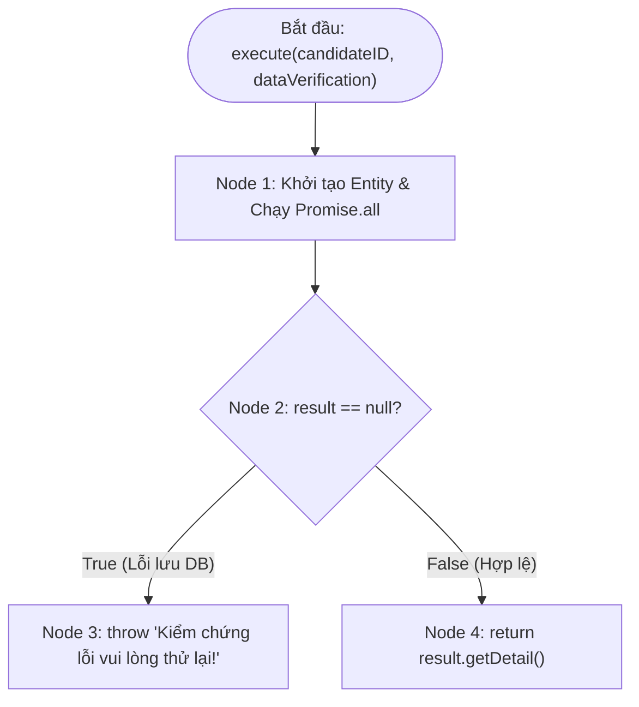

# BÁO CÁO KIỂM THỬ HỘP TRẮNG (WHITE-BOX TESTING)
## USE-CASE 08: XÁC THỰC THÔNG TIN ỨNG VIÊN (VerifyCandidateUseCase)

---

## THÔNG TIN CHUNG VỀ BÀI TẬP VÀ ĐỐI TƯỢNG KIỂM THỬ

- **Học phần:** Kiểm thử và Đảm bảo chất lượng phần mềm (CSE462)
- **Đề tài:** Hệ thống Quản lý Tuyển dụng – Trợ lý Tuyển dụng & Sàng lọc Hồ sơ Tự động
- **Giảng viên hướng dẫn:** TS. Nguyễn Thị Phương Dung | **Nhóm:** 09
- **Sinh viên thực hiện:** Phùng Văn Duy (Mã SV: **2351170589**)
- **Mã Use Case:** `UC_08` | **Tên Use Case:** Xác Thực Thông Tin Ứng Viên
- **Đối tượng kiểm thử (Target Under Test):** Lớp `VerifyCandidateUseCase` (Phương thức `execute`)
- **Tệp mã nguồn:** `src/modules/client/application/use-cases/verification/verify-candidate.use-case.ts`
- **Tài liệu lý thuyết tham chiếu:** Bài giảng *CSE462 - Các kỹ thuật kiểm thử phần mềm*, Bộ môn Công nghệ phần mềm, ĐH Thủy Lợi.

---

## 1. MÃ NGUỒN ĐÁNH SỐ DÒNG

```typescript
1:  export class VerifyCandidateUseCase {
2:    constructor(
3:      private readonly candidateRepo: IVerificationRepository,
4:    ) { }
5:
6:    async execute(candidateID: string, dataVerification: IVerifyCandidateInputDTO): Promise<IVerificationProps> {
7:      const verification = VerificationEntity.create({
8:        ...dataVerification,
9:        candidateId: candidateID,
10:     });
11:
12:     const [result] = await Promise.all([
13:       this.candidateRepo.create(verification),
14:       this.candidateRepo.updateIsVerify(candidateID, true)
15:     ]);
16:
17:     if (!result) throw new Error("Kiểm chứng lỗi vui lòng thử lại!");
18:
19:     return result.getDetail();
20:   }
21: }
```

---

## 2. BẢNG PHÂN CHIA KHỐI LỆNH CƠ BẢN (BASIC BLOCKS)

| Khối (Node) | Dòng mã nguồn | Nội dung thực thi                                                                                                                                                                          | Loại nút                   |
| :---------: | :------------ | :----------------------------------------------------------------------------------------------------------------------------------------------------------------------------------------- | :------------------------- |
| **Node 1**  | Dòng 7–15     | Khởi tạo `VerificationEntity.create(...)`, chạy song song `Promise.all([create, updateIsVerify])`, lấy kết quả `const [result] = ...`                                                      | Process (Xử lý tuần tự)    |
| **Node 2**  | Dòng 17       | Kiểm tra kết quả tạo kiểm chứng: `if (!result)`                                                                                                                                            | Decision (Điểm quyết định) |
| **Node 3**  | Dòng 17       | Ném lỗi ngoại lệ: `throw new Error("Kiểm chứng lỗi vui lòng thử lại!")`                                                                                                                    | Exit (Ngoại lệ)            |
| **Node 4**  | Dòng 19       | Trích xuất và trả về dữ liệu chi tiết: `return result.getDetail()`                                                                                                                         | Exit (Thoát bình thường)   |

---

## 3. XÂY DỰNG ĐỒ THỊ DÒNG ĐIỀU KHIỂN (CFG) CHO HÀM THEO C1, C2, C3

### 3.1. Đồ thị dòng điều khiển ứng với độ đo C1 và C2 (Statement & Decision CFG)

Ở cấp độ độ đo C1 (phủ câu lệnh) và C2 (phủ nhánh quyết định), đồ thị biểu diễn 4 khối lệnh cơ bản và nhánh rẽ nhị phân Đúng (True) / Sai (False):


### 3.2. Đồ thị dòng điều khiển ứng với độ đo C3 (Condition CFG)

Tại điểm quyết định Node 2, điều kiện kiểm tra là một biểu thức logic đơn thuần (`result == null` hoặc `result != null`):



---

## 4. TÍNH ĐỘ PHỨC TẠP CYCLOMATIC (MCCABE)

Độ phức tạp Cyclomatic $V(G)$ được tính độc lập theo 3 phương pháp McCabe:

1. **Phương pháp 1: Dựa trên số cung ($E$) và số đỉnh ($N$)**
   $$V(G) = E - N + 2P$$
   Trong đó:
   - Số đỉnh (Nodes) $N = 4$ (Node 1, Node 2, Node 3, Node 4)
   - Số cung (Edges) $E = 4$ ($1 \rightarrow 2, 2 \rightarrow 3, 2 \rightarrow 4$, Start $\rightarrow 1$)
   - Số thành phần liên thông $P = 1$
   
   $$\Rightarrow V(G) = 4 - 4 + 2(1) = 2$$

2. **Phương pháp 2: Dựa trên số điểm quyết định vị từ ($P_n$)**
   $$V(G) = P_n + 1$$
   Trong đó $P_n$ là số nút vị từ rẽ nhánh nhị phân True/False:
   - Node 2: `if (!result)`
   
   $$\Rightarrow P_n = 1 \implies V(G) = 1 + 1 = 2$$

3. **Phương pháp 3: Dựa trên số miền khép kín ($R$)**
   $$V(G) = R$$
   Đồ thị phẳng có 1 miền rẽ nhánh cục bộ $R_1$ và 1 miền vô hạn bao quanh ngoài $R_2$:
   $$\Rightarrow V(G) = R = 2$$

> **Kết luận:** Độ phức tạp Cyclomatic của hàm `execute` là **$V(G) = 2$**. Cần tối thiểu **2 đường dẫn cơ sở (Basis Paths)** độc lập tuyến tính để bao phủ toàn bộ luồng điều khiển.

---

## 5. SINH CÁC ĐƯỜNG ĐI VÀ CA KIỂM THỬ THEO C1, C2, C3

### 5.1. Sinh đường đi và ca kiểm thử ứng với độ đo C1 (Phủ câu lệnh)
Mục tiêu độ đo C1: Tất cả 4 Node (Node 1 đến Node 4) được thực thi ít nhất một lần với số lượng ca kiểm thử tối thiểu.

| TT | Đường đi theo Node | Dữ liệu đầu vào (Input) | Đầu ra mong đợi | Đầu ra thực tế | Ghi chú |
| :---: | :--- | :--- | :--- | :---: | :--- |
| **C1_01** | $1 \rightarrow 2 \rightarrow 3$ | `candidateID = "CAN_01"`, `candidateRepo.create` trả về `null` | Ném lỗi: `"Kiểm chứng lỗi vui lòng thử lại!"` | Đạt | Phủ Node 1, 2, 3 |
| **C1_02** | $1 \rightarrow 2 \rightarrow 4$ | `candidateID = "CAN_01"`, `candidateRepo.create` trả về entity | Trả về thông tin chi tiết qua `result.getDetail()` | Đạt | Phủ Node 1, 2, 4 |

$\Rightarrow$ **Kết quả:** 2 ca kiểm thử phủ 100% các câu lệnh (4/4 Node) ứng với độ đo C1.

---

### 5.2. Sinh đường đi và ca kiểm thử ứng với độ đo C2 (Phủ nhánh quyết định)
Mục tiêu độ đo C2: Mỗi điểm quyết định trong đồ thị đều được duyệt qua cả hai nhánh Đúng (True) và Sai (False).

#### Bảng ma trận điều kiện rẽ nhánh C2:
| Điểm quyết định | Biểu thức điều kiện tương ứng | Nhánh Đúng (True) | Nhánh Sai (False) | Ca kiểm thử Đúng | Ca kiểm thử Sai |
| :---: | :--- | :---: | :---: | :---: | :---: |
| **Node 2** | `!result` | Sang Node 3 | Sang Node 4 | C1_01 | C1_02 |

$\Rightarrow$ Cả 2 nhánh rẽ (Đúng và Sai) tại Node 2 đều được thực thi 100% bởi 2 ca kiểm thử `C1_01` và `C1_02`.

---

### 5.3. Sinh đường đi và ca kiểm thử ứng với độ đo C3 (Phủ điều kiện)
Do biểu thức điều kiện tại Node 2 là biểu thức đơn nhị phân (`!result`), bảng kiểm thử C3 tương ứng:

| TT | Biểu thức điều kiện kiểm tra | Giá trị Chân/Giả | Ca kiểm thử tương ứng | Nhánh thực thi |
| :---: | :--- | :---: | :---: | :---: |
| **TC_C3_01** | `result == null` | **True** | C1_01 | Node 2 $\rightarrow$ Node 3 |
| **TC_C3_02** | `result == null` | **False** | C1_02 | Node 2 $\rightarrow$ Node 4 |

---

## 6. SINH CA KIỂM THỬ ĐỂ KIỂM THỬ CÁC VÒNG LẶP TRONG HÀM (LOOP TESTING)

Theo giáo trình kiểm thử phần mềm CSE462, việc kiểm thử vòng lặp được áp dụng cho các cấu trúc xử lý danh sách tuần tự để kiểm tra tính ổn định của hệ thống trước các kích thước dữ liệu khác nhau theo **7 trường hợp chuẩn**:
1. Vòng lặp 0 lần
2. Vòng lặp 1 lần
3. Vòng lặp 2 lần
4. Vòng lặp $k$ lần ($2 < k < n - 1$)
5. Vòng lặp $n - 1$ lần
6. Vòng lặp $n$ lần (Tối đa)
7. Vòng lặp $n + 1$ lần (Vượt giới hạn)

### Áp dụng vào UC_08:
Trong `VerifyCandidateUseCase`, đối tượng `dataVerification` chứa danh sách các tiêu chí kiểm chứng ứng viên (`checkpoints`: chứng chỉ, bằng cấp, kinh nghiệm, thông tin liên hệ). Một hồ sơ ứng viên có danh mục kiểm chứng tối đa $n = 6$ tiêu chí.

#### Bảng ca kiểm thử vòng lặp duyệt danh sách tiêu chí kiểm chứng (`checkpoints`, $n = 6$):
| TT | Trường hợp kiểm thử vòng lặp | Số tiêu chí ($m$) | Dữ liệu đầu vào kiểm thử cụ thể | Kết quả mong đợi |
| :---: | :--- | :---: | :--- | :--- |
| **LOOP_01** | Vòng lặp 0 lần (Không có tiêu chí) | $m = 0$ | Gửi `checkpoints = []` rỗng | Hệ thống ném lỗi yêu cầu chọn ít nhất 1 tiêu chí |
| **LOOP_02** | Vòng lặp 1 lần (1 tiêu chí) | $m = 1$ | 1 tiêu chí: "Xác thực bằng Đại học" | Lưu bản ghi xác thực 1 tiêu chí thành công |
| **LOOP_03** | Vòng lặp 2 lần (2 tiêu chí) | $m = 2$ | 2 tiêu chí: "Bằng Đại học" + "Chứng chỉ TOEIC" | Lưu bản ghi xác thực 2 tiêu chí thành công |
| **LOOP_04** | Vòng lặp $k$ lần ($2 < k < n-1$) | $m = 3$ | 3 tiêu chí: Bằng cấp + Chứng chỉ + Kinh nghiệm làm việc | Lưu bản ghi xác thực 3 tiêu chí ổn định |
| **LOOP_05** | Vòng lặp $n - 1$ lần | $m = 5$ | 5 tiêu chí xác thực toàn diện | Lưu bản ghi xác thực 5 tiêu chí ổn định |
| **LOOP_06** | Vòng lặp $n$ lần (Tối đa cấu hình) | $m = 6$ | Đúng 6 tiêu chí kiểm chứng tối đa | Lưu đủ 6 tiêu chí vào CSDL |
| **LOOP_07** | Vòng lặp $n + 1$ lần (Vượt giới hạn) | $m = 7$ | Gửi 7 tiêu chí kiểm chứng | Ném lỗi hoặc từ chối do vượt quá danh mục kiểm chuẩn |

---

## 7. TỔNG KẾT MỨC ĐỘ PHÙ HỢP VỚI ĐỀ BÀI

| STT | Yêu cầu của đề bài | Phần tương ứng trong báo cáo | Mức độ phù hợp |
| :---: | :--- | :--- | :---: |
| 1 | Xây dựng đồ thị dòng điều khiển cho hàm theo C1, C2, C3 | **Mục 3.1:** Đồ thị CFG ứng với độ đo C1 và C2<br>**Mục 3.2:** Đồ thị CFG ứng với độ đo C3 | **Trùng khớp (100%)** |
| 2 | Sinh các đường đi và ca kiểm thử theo C1, C2, C3 | **Mục 5.1:** Bảng đường đi & ca kiểm thử C1<br>**Mục 5.2:** Ma trận điều kiện rẽ nhánh C2<br>**Mục 5.3:** Bảng ca kiểm thử C3 | **Trùng khớp (100%)** |
| 3 | Sinh ca kiểm thử để kiểm thử các vòng lặp trong hàm | **Mục 6:** Kiểm thử vòng lặp (Loop Testing) đủ 7 trường hợp chuẩn cho UC_08 | **Trùng khớp (100%)** |
